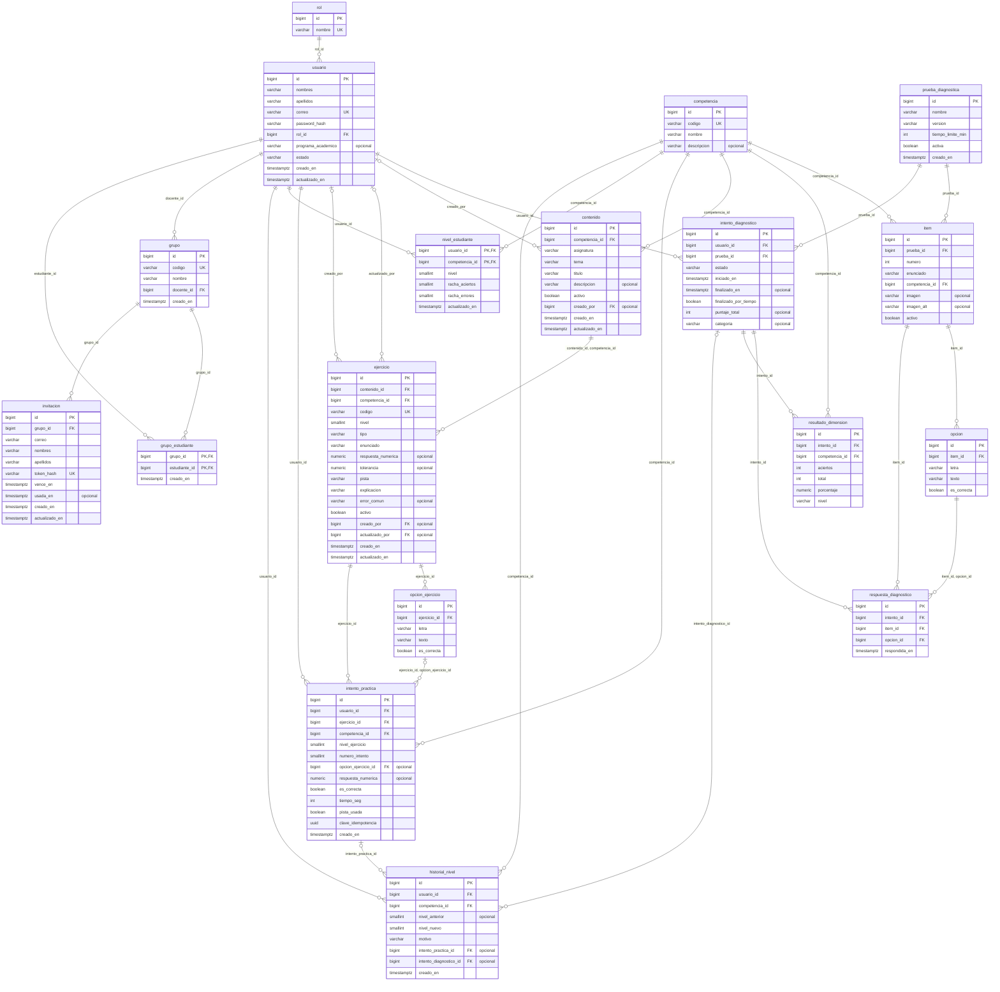
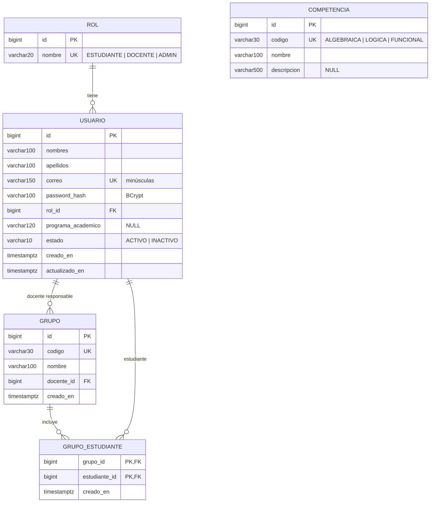
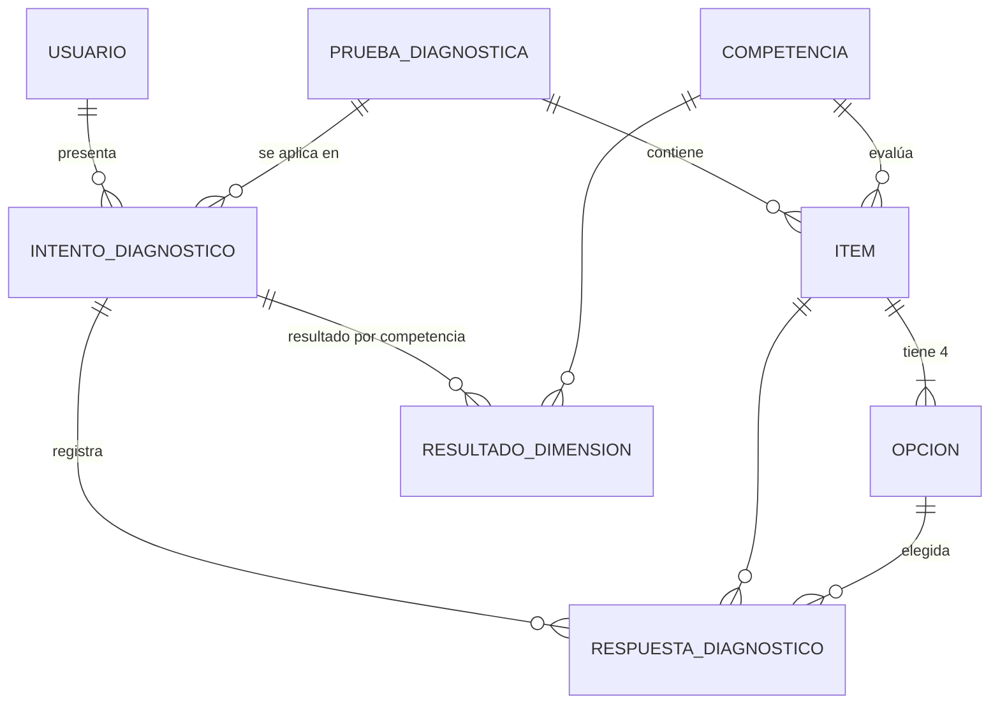
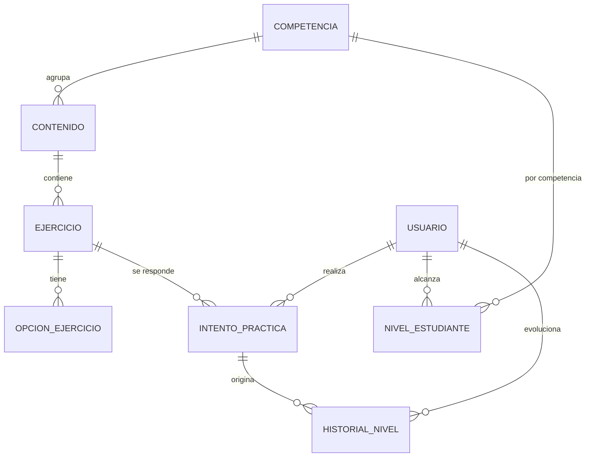

# Modelo físico

Migraciones (`src/main/resources/db/migration/`):

| Migración | Contenido |
|---|---|
| `V1__esquema_inicial.sql` | Tablas `rol`, `usuario`, `competencia` |
| `V2__datos_base_roles_competencias.sql` | Los 3 roles y las 3 competencias |
| `V3__esquema_diagnostico.sql` | Tablas de la prueba diagnóstica (ver [Prueba diagnóstica](#prueba-diagnóstica)) |
| `V4__datos_prueba_diagnostica.sql` | La prueba v2.0 activa (36 min), sus 24 ítems y 96 opciones con su clave |
| `V5__esquema_practica.sql` | Contenidos, ejercicios, opciones, intentos, niveles e historial de nivel |
| `V6__datos_ejercicios_semilla.sql` | 90 ejercicios semilla: 45 de Cálculo Diferencial y 45 de Cálculo Integral |
| `V7__crear_grupos_docentes_estudiantes.sql` | Tablas `grupo` y `grupo_estudiante` (antes `V202610242250__…`; se renombró para la numeración consecutiva) |
| `V8__crear_invitaciones.sql` | Tabla `invitacion` para el registro de estudiantes por invitación |
| `db/dev-data/R__usuarios_de_prueba.sql` | Usuarios de prueba; solo con el perfil `dev` |

Motor: PostgreSQL 17. Convención: tablas y columnas en `snake_case` singular; restricciones `pk_`, `fk_`, `uq_`, `ck_`; índices `ix_`.

## Diagrama completo (as-built)

Las 18 tablas y sus 31 relaciones.

**De dónde sale.** Se generó el 1 de noviembre de 2026 a partir de la base real, con todas las migraciones aplicadas, consultando `information_schema` y `pg_constraint`. Si una migración nueva cambia el esquema, actualiza este diagrama en el mismo PR.

**Cómo leerlo.**
- Cada relación lleva el nombre de la columna de la clave foránea.
- `||` indica una relación obligatoria y `o|` una opcional.
- `UK` marca las columnas únicas por sí solas.

**Reglas que el diagrama no muestra:**

| Tipo | Regla |
|---|---|
| Únicos compuestos | `contenido` (asignatura, tema, titulo) · `intento_practica` (usuario_id, clave_idempotencia) y (usuario_id, ejercicio_id, numero_intento) · `item` (prueba_id, numero) · `opcion` (item_id, letra) · `opcion_ejercicio` (ejercicio_id, letra) · `prueba_diagnostica` (nombre, version) · `respuesta_diagnostico` (intento_id, item_id) · `resultado_dimension` (intento_id, competencia_id) |
| Claves foráneas compuestas | `ejercicio` (contenido_id, competencia_id) → `contenido`: el ejercicio queda en la competencia de su contenido · `respuesta_diagnostico` (opcion_id, item_id) → `opcion`: la opción es de la misma pregunta · `intento_practica` (opcion_ejercicio_id, ejercicio_id) → `opcion_ejercicio` |
| Índices únicos parciales | `uq_intento_en_curso`: un solo intento EN_CURSO por estudiante y prueba · `uq_opcion_una_correcta` y `uq_opcion_ejercicio_una_correcta`: una sola respuesta correcta · `uq_prueba_una_activa`: una sola prueba activa |

## grupo y grupo_estudiante

| Tabla | Columnas y restricciones |
|---|---|
| `grupo` | `id` identidad; `codigo` único y en mayúsculas; `nombre`; `docente_id` → `usuario.id`; `creado_en` |
| `grupo_estudiante` | Clave primaria compuesta (`grupo_id`, `estudiante_id`), con claves foráneas a `grupo` y `usuario`; `creado_en` |

La aplicación valida que `docente_id` pertenezca a un usuario con rol `DOCENTE` y que `estudiante_id` corresponda a un estudiante activo. La clave primaria compuesta impide inscripciones duplicadas. Los índices `ix_grupo_docente_id` e `ix_grupo_estudiante_estudiante_id` permiten filtrar por responsable y localizar las asociaciones de un estudiante. Las operaciones de docentes verifican que el responsable autenticado coincida con el grupo.

## invitacion

| Columna | Tipo | Nulo | Restricciones |
|---|---|---|---|
| id | BIGINT GENERATED ALWAYS AS IDENTITY | No | `pk_invitacion` |
| grupo_id | BIGINT | No | `fk_invitacion_grupo` → `grupo.id` (ON DELETE CASCADE); `ix_invitacion_grupo_id` |
| correo | VARCHAR(150) | No | `uq_invitacion_grupo_correo`; `ck_invitacion_correo_minuscula`; `ix_invitacion_correo` |
| nombres | VARCHAR(100) | No | |
| apellidos | VARCHAR(100) | No | |
| token_hash | VARCHAR(64) | No | `uq_invitacion_token_hash` (SHA-256, nunca el token en claro) |
| vence_en | TIMESTAMPTZ | No | |
| usada_en | TIMESTAMPTZ | Sí | Marca el registro consumido |
| creado_en | TIMESTAMPTZ | No | `now()` |
| actualizado_en | TIMESTAMPTZ | No | `now()` |

La invitación es la fuente de verdad antes de que exista la cuenta: guarda el correo y los nombres del listado. Al registrarse se crea el usuario, se inserta la fila de `grupo_estudiante` y se marca `usada_en` en la misma transacción. El token solo viaja en el enlace de correo; en la base queda su hash.

## rol

| Columna | Tipo | Nulo | Restricciones |
|---|---|---|---|
| id | BIGINT GENERATED ALWAYS AS IDENTITY | No | `pk_rol` |
| nombre | VARCHAR(20) | No | `uq_rol_nombre`; `ck_rol_nombre`: ESTUDIANTE, DOCENTE, ADMIN |

## usuario

| Columna | Tipo | Nulo | Restricciones / valor por defecto |
|---|---|---|---|
| id | BIGINT GENERATED ALWAYS AS IDENTITY | No | `pk_usuario` |
| nombres | VARCHAR(100) | No | |
| apellidos | VARCHAR(100) | No | |
| correo | VARCHAR(150) | No | `uq_usuario_correo` (crea el índice de búsqueda); `ck_usuario_correo_minuscula` |
| password_hash | VARCHAR(100) | No | Hash BCrypt (60 caracteres) |
| rol_id | BIGINT | No | `fk_usuario_rol` → rol.id; índice `ix_usuario_rol_id` |
| programa_academico | VARCHAR(120) | Sí | Solo estudiantes |
| estado | VARCHAR(10) | No | `ck_usuario_estado`: ACTIVO, INACTIVO; por defecto ACTIVO |
| creado_en | TIMESTAMPTZ | No | por defecto `now()` |
| actualizado_en | TIMESTAMPTZ | No | por defecto `now()`; lo actualiza Hibernate |

## competencia

| Columna | Tipo | Nulo | Restricciones |
|---|---|---|---|
| id | BIGINT GENERATED ALWAYS AS IDENTITY | No | `pk_competencia` |
| codigo | VARCHAR(30) | No | `uq_competencia_codigo`; `ck_competencia_codigo` (mayúsculas) |
| nombre | VARCHAR(100) | No | |
| descripcion | VARCHAR(500) | Sí | |

## Decisiones

| Decisión | Motivo |
|---|---|
| Identidad `GENERATED ALWAYS` | Nadie puede insertar ids a mano; evita choques con la secuencia. |
| Correo en minúsculas (entidad + CHECK) | "Ana@USCO.edu.co" y "ana@usco.edu.co" son la misma persona; el UNIQUE solo funciona si todo se guarda igual. |
| Sin índice extra en `correo` | La restricción UNIQUE ya crea un índice, que es el que usa el login. |
| `estado` como texto con CHECK (no BOOLEAN) | Permite agregar estados (por ejemplo, BLOQUEADO) sin migrar datos. |
| `rol.nombre` como enum en Java, `competencia.codigo` como texto | Los roles son fijos por diseño. Las competencias deben poder crecer con una migración de datos, sin tocar código (RNF-09). |
| `TIMESTAMPTZ` | Guarda el instante exacto sin ambigüedad de zona horaria (Colombia UTC-5 vs. servidor en UTC). |
| Usuarios de prueba en `db/dev-data` (migración repetible) | Solo existen con el perfil `dev`; nunca en pruebas ni en producción. |

## Prueba diagnóstica

### prueba_diagnostica

| Columna | Tipo | Nulo | Restricciones / valor por defecto |
|---|---|---|---|
| id | BIGINT IDENTITY | No | `pk_prueba_diagnostica` |
| nombre | VARCHAR(150) | No | `uq_prueba_nombre_version` (nombre, version) |
| version | VARCHAR(20) | No | |
| tiempo_limite_min | INTEGER | No | `> 0` (la v2.0 usa 36) |
| activa | BOOLEAN | No | por defecto FALSE; índice parcial único `uq_prueba_una_activa`: **solo una activa** |
| creado_en | TIMESTAMPTZ | No | por defecto `now()` |

### item

| Columna | Tipo | Nulo | Restricciones |
|---|---|---|---|
| id | BIGINT IDENTITY | No | `pk_item` |
| prueba_id | BIGINT | No | FK → prueba_diagnostica; `uq_item_prueba_numero` (prueba_id, numero) |
| numero | INTEGER | No | orden de presentación, `> 0` |
| enunciado | VARCHAR(1000) | No | notación matemática entre `$…$` |
| competencia_id | BIGINT | No | FK → competencia; índice `ix_item_competencia_id` |
| imagen | VARCHAR(200) | Sí | ruta en el frontend |
| imagen_alt | VARCHAR(500) | Sí | `ck_item_imagen_alt`: obligatorio si hay imagen (accesibilidad) |
| activo | BOOLEAN | No | por defecto TRUE |

### opcion

| Columna | Tipo | Nulo | Restricciones |
|---|---|---|---|
| id | BIGINT IDENTITY | No | `pk_opcion`; `uq_opcion_id_item` (id, item_id) para la FK compuesta de respuesta |
| item_id | BIGINT | No | FK → item (ON DELETE CASCADE); `uq_opcion_item_letra` (item_id, letra) |
| letra | VARCHAR(1) | No | A, B, C o D |
| texto | VARCHAR(500) | No | |
| es_correcta | BOOLEAN | No | índice parcial único `uq_opcion_una_correcta`: **una sola clave por ítem** |

### intento_diagnostico

| Columna | Tipo | Nulo | Restricciones / valor por defecto |
|---|---|---|---|
| id | BIGINT IDENTITY | No | `pk_intento_diagnostico` |
| usuario_id | BIGINT | No | FK → usuario |
| prueba_id | BIGINT | No | FK → prueba_diagnostica; índice `ix_intento_prueba_id` |
| estado | VARCHAR(12) | No | EN_CURSO o FINALIZADO; por defecto EN_CURSO |
| iniciado_en | TIMESTAMPTZ | No | por defecto `now()` |
| finalizado_en | TIMESTAMPTZ | Sí | `ck_intento_fechas`: no antes del inicio |
| finalizado_por_tiempo | BOOLEAN | No | por defecto FALSE |
| puntaje_total | INTEGER | Sí | 0 o más |
| categoria | VARCHAR(20) | Sí | ALTO_RIESGO, RIESGO_MODERADO o NIVEL_ADECUADO |

- `ck_intento_coherente`: EN_CURSO no tiene fin, puntaje ni categoría; FINALIZADO tiene los tres.
- Índice parcial único `uq_intento_en_curso` (usuario_id, prueba_id) WHERE estado = 'EN_CURSO': nunca dos intentos abiertos del mismo estudiante en la misma prueba. Que haya **un solo intento en total** lo controla el servicio, para poder habilitar un segundo intento en el futuro sin migrar.

### respuesta_diagnostico

| Columna | Tipo | Nulo | Restricciones / valor por defecto |
|---|---|---|---|
| id | BIGINT IDENTITY | No | `pk_respuesta_diagnostico` |
| intento_id | BIGINT | No | FK → intento_diagnostico (ON DELETE CASCADE); `uq_respuesta_intento_item` (intento_id, item_id): una respuesta por pregunta |
| item_id | BIGINT | No | FK → item; índice `ix_respuesta_item_id` |
| opcion_id | BIGINT | No | `fk_respuesta_opcion_item` (opcion_id, item_id) → opcion (id, item_id): **la opción debe ser de la misma pregunta** |
| respondida_en | TIMESTAMPTZ | No | por defecto `now()`; se actualiza si cambia la respuesta |

### resultado_dimension

| Columna | Tipo | Nulo | Restricciones |
|---|---|---|---|
| id | BIGINT IDENTITY | No | `pk_resultado_dimension` |
| intento_id | BIGINT | No | FK → intento_diagnostico (ON DELETE CASCADE); `uq_resultado_intento_competencia` |
| competencia_id | BIGINT | No | FK → competencia; índice `ix_resultado_competencia_id` |
| aciertos | INTEGER | No | 0 ≤ aciertos ≤ total |
| total | INTEGER | No | `> 0` |
| porcentaje | NUMERIC(5,2) | No | 0 a 100 |
| nivel | VARCHAR(10) | No | BAJO, MEDIO o ALTO |

Se guarda al finalizar (no se recalcula al consultar): así el resultado histórico no cambia si después se corrige un ítem, y los reportes del docente son consultas simples.

## Diferencias con el modelo conceptual (Figura 6, capítulo 4)

- `usuario.nombre` se divide en `nombres` y `apellidos`; se agregan `password_hash`, `programa_academico`, `creado_en` y `actualizado_en`.
- `competencia` gana `codigo` (identificador estable para el código y los reportes).
- `diagnostico`, `intento` y `resultado` del modelo conceptual quedan como `prueba_diagnostica` + `item` + `opcion`, `intento_diagnostico` + `respuesta_diagnostico` y `resultado_dimension` (el puntaje global vive en el intento).
- `contenido` y `ejercicio` se incorporan en la migración de práctica.
- `progreso` no tiene tablas propias: el historial (SCRUM-41) consulta `intento_diagnostico`, `resultado_dimension` e `intento_practica`.
- `grupo` y `grupo_estudiante` (SCRUM-159) no estaban en el modelo conceptual: permiten que el docente vea solo a los estudiantes de sus grupos.

## Práctica adaptativa

### contenido

| Columna | Tipo | Nulo | Restricciones |
|---|---|---|---|
| id | BIGINT IDENTITY | No | `pk_contenido` |
| competencia_id | BIGINT | No | FK → competencia |
| asignatura | VARCHAR(80) | No | `CALCULO_DIFERENCIAL` o `CALCULO_INTEGRAL` |
| tema | VARCHAR(120) | No | Texto normalizado; puede crecer sin cambio de esquema |
| titulo | VARCHAR(150) | No | `uq_contenido_titulo (asignatura, tema, titulo)` |
| descripcion | VARCHAR(500) | Sí | — |
| activo | BOOLEAN | No | Default TRUE |
| creado_por | BIGINT | Sí | FK → usuario; NULL en la semilla |
| creado_en / actualizado_en | TIMESTAMPTZ | No | Auditoría |

### ejercicio

| Columna | Tipo | Nulo | Restricciones |
|---|---|---|---|
| id | BIGINT IDENTITY | No | `pk_ejercicio` |
| contenido_id | BIGINT | No | FK compuesta con competencia |
| competencia_id | BIGINT | No | `fk_ejercicio_contenido_competencia` |
| codigo | VARCHAR(40) | No | `uq_ejercicio_codigo` |
| nivel | SMALLINT | No | CHECK 1–3 |
| tipo | VARCHAR(20) | No | `OPCION_MULTIPLE` o `NUMERICA` |
| enunciado | VARCHAR(2000) | No | Texto con LaTeX |
| respuesta_numerica | NUMERIC(20,6) | Sí | Solo tipo numérico |
| tolerancia | NUMERIC(20,6) | Sí | Solo tipo numérico; `> 0` |
| pista / explicacion | VARCHAR(1000/2000) | No | Retroalimentación |
| error_comun | VARCHAR(1000) | Sí | — |
| activo | BOOLEAN | No | Default TRUE |
| creado_por / actualizado_por | BIGINT | Sí | FK → usuario |
| creado_en / actualizado_en | TIMESTAMPTZ | No | Auditoría |

La FK compuesta `(contenido_id, competencia_id)` impide que un ejercicio quede en una competencia distinta a la de su contenido.

### opcion_ejercicio

| Columna | Tipo | Nulo | Restricciones |
|---|---|---|---|
| id | BIGINT IDENTITY | No | PK; `uq_opcion_ejercicio_id_ejercicio` |
| ejercicio_id | BIGINT | No | FK → ejercicio ON DELETE CASCADE |
| letra | VARCHAR(1) | No | A–D; `uq_opcion_ejercicio_letra` |
| texto | VARCHAR(500) | No | — |
| es_correcta | BOOLEAN | No | Índice parcial único: una sola correcta por ejercicio |

### intento_practica

| Columna | Tipo | Nulo | Restricciones |
|---|---|---|---|
| id | BIGINT IDENTITY | No | PK |
| usuario_id | BIGINT | No | FK → usuario |
| ejercicio_id | BIGINT | No | FK → ejercicio |
| competencia_id | BIGINT | No | Snapshot de competencia |
| nivel_ejercicio | SMALLINT | No | Snapshot del nivel |
| numero_intento | SMALLINT | No | 1 o 2 |
| opcion_ejercicio_id | BIGINT | Sí | FK compuesta → opcion_ejercicio(id, ejercicio_id) |
| respuesta_numerica | NUMERIC(20,6) | Sí | Solo una respuesta |
| es_correcta | BOOLEAN | No | Resultado calculado |
| tiempo_seg | INTEGER | No | 0–86400 |
| pista_usada | BOOLEAN | No | Default FALSE |
| clave_idempotencia | UUID | No | `uq_intento_practica_idempotencia (usuario_id, clave)` |
| creado_en | TIMESTAMPTZ | No | Fecha del intento |

Restricciones: `uq_intento_practica_numero (usuario_id, ejercicio_id, numero_intento)` y CHECK de exactamente una respuesta (opción o numérica).

### nivel_estudiante

| Columna | Tipo | Nulo | Restricciones |
|---|---|---|---|
| usuario_id | BIGINT | No | PK compuesta, FK → usuario |
| competencia_id | BIGINT | No | PK compuesta, FK → competencia |
| nivel | SMALLINT | No | CHECK 1–3 |
| racha_aciertos | SMALLINT | No | `>= 0` |
| racha_errores | SMALLINT | No | `>= 0` |
| actualizado_en | TIMESTAMPTZ | No | Auditoría |

### historial_nivel

| Columna | Tipo | Nulo | Restricciones |
|---|---|---|---|
| id | BIGINT IDENTITY | No | PK |
| usuario_id / competencia_id | BIGINT | No | FKs |
| nivel_anterior / nivel_nuevo | SMALLINT | Sí / No | 1–3 |
| motivo | VARCHAR(30) | No | `INICIALIZACION`, `DIAGNOSTICO`, `RACHA_ACIERTOS`, `RACHA_ERRORES`, `AJUSTE_MANUAL` |
| intento_practica_id | BIGINT | Sí | FK → intento_practica |
| intento_diagnostico_id | BIGINT | Sí | FK → intento_diagnostico |
| creado_en | TIMESTAMPTZ | No | Auditoría |

### Decisiones de práctica

- La retroalimentación vive en `ejercicio`; no se crea una tabla de feedback en el MVP. Si luego se audita el feedback mostrado, se agrega una tabla o columna nullable.
- La semilla tiene `creado_por = NULL`; los contenidos docentes lo llenan.
- Un ejercicio con intentos no se borra: se desactiva. Los cambios estructurales se rechazan y se crea un ejercicio nuevo.
- `intento_practica` conserva snapshots de competencia y nivel para no perder el historial si el ejercicio cambia.
- Los intentos son inmutables.
- Los nuevos ejercicios creados por docentes se insertan por la aplicación, no por Flyway.
- Las materias se validan por configuración (`app.practica.asignaturas`); los temas son texto y no requieren tablas adicionales.
