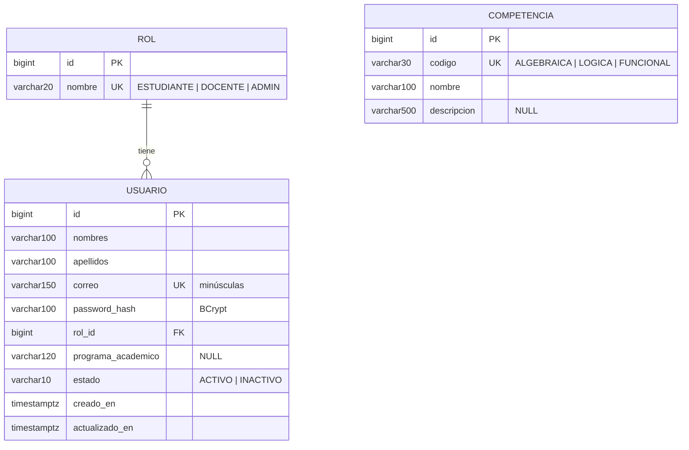

# Modelo físico — esquema inicial

Migraciones: `src/main/resources/db/migration/V1__esquema_inicial.sql` (tablas) y `V2__datos_base_roles_competencias.sql` (datos base).
Motor: PostgreSQL 17. Convención: tablas y columnas en `snake_case` singular; restricciones `pk_`, `fk_`, `uq_`, `ck_`; índices `ix_`.

## rol

| Columna | Tipo | Nulo | Restricciones |
|---|---|---|---|
| id | BIGINT GENERATED ALWAYS AS IDENTITY | No | `pk_rol` |
| nombre | VARCHAR(20) | No | `uq_rol_nombre`; `ck_rol_nombre`: ESTUDIANTE, DOCENTE, ADMIN |

## usuario

| Columna | Tipo | Nulo | Restricciones / valor por defecto |
|---|---|---|---|
| id | BIGINT GENERATED ALWAYS AS IDENTITY | No | `pk_usuario` |
| nombres | VARCHAR(100) | No | |
| apellidos | VARCHAR(100) | No | |
| correo | VARCHAR(150) | No | `uq_usuario_correo` (crea el índice de búsqueda); `ck_usuario_correo_minuscula` |
| password_hash | VARCHAR(100) | No | Hash BCrypt (60 caracteres) |
| rol_id | BIGINT | No | `fk_usuario_rol` → rol.id; índice `ix_usuario_rol_id` |
| programa_academico | VARCHAR(120) | Sí | Solo estudiantes |
| estado | VARCHAR(10) | No | `ck_usuario_estado`: ACTIVO, INACTIVO; por defecto ACTIVO |
| creado_en | TIMESTAMPTZ | No | por defecto `now()` |
| actualizado_en | TIMESTAMPTZ | No | por defecto `now()`; lo actualiza Hibernate |

## competencia

| Columna | Tipo | Nulo | Restricciones |
|---|---|---|---|
| id | BIGINT GENERATED ALWAYS AS IDENTITY | No | `pk_competencia` |
| codigo | VARCHAR(30) | No | `uq_competencia_codigo`; `ck_competencia_codigo` (mayúsculas) |
| nombre | VARCHAR(100) | No | |
| descripcion | VARCHAR(500) | Sí | |

## Decisiones

| Decisión | Motivo |
|---|---|
| Identidad `GENERATED ALWAYS` | Nadie puede insertar ids a mano; evita choques con la secuencia. |
| Correo en minúsculas (entidad + CHECK) | "Ana@USCO.edu.co" y "ana@usco.edu.co" son la misma persona; el UNIQUE solo funciona si todo se guarda igual. |
| Sin índice extra en `correo` | La restricción UNIQUE ya crea un índice, que es el que usa el login. |
| `estado` como texto con CHECK (no BOOLEAN) | Permite agregar estados (por ejemplo, BLOQUEADO) sin migrar datos. |
| `rol.nombre` como enum en Java, `competencia.codigo` como texto | Los roles son fijos por diseño. Las competencias deben poder crecer con una migración de datos, sin tocar código (RNF-09). |
| `TIMESTAMPTZ` | Guarda el instante exacto sin ambigüedad de zona horaria (Colombia UTC-5 vs. servidor en UTC). |
| Usuarios de prueba en `db/dev-data` (migración repetible) | Solo existen con el perfil `dev`; nunca en pruebas ni en producción. |

## Diferencias con el modelo conceptual (Figura 6, capítulo 4)

- `usuario.nombre` se divide en `nombres` y `apellidos`; se agregan `password_hash`, `programa_academico`, `creado_en` y `actualizado_en`.
- `competencia` gana `codigo` (identificador estable para el código y los reportes).
- Pendiente en tareas posteriores: `contenido`, `ejercicio`, `diagnostico`, `intento`, `resultado`, `progreso` y la tabla `grupo` (asociación docente–estudiante, que no estaba en la Figura 6).
