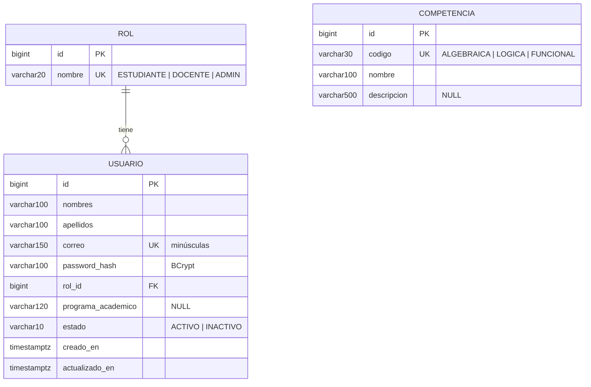
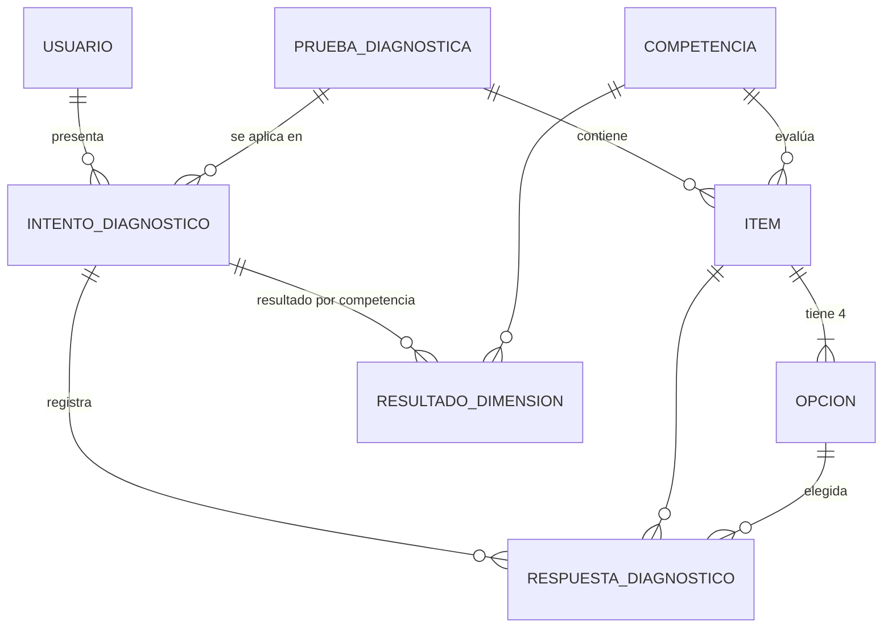

# Modelo físico

Migraciones (`src/main/resources/db/migration/`):

| Migración | Contenido |
|---|---|
| `V1__esquema_inicial.sql` | Tablas `rol`, `usuario`, `competencia` |
| `V2__datos_base_roles_competencias.sql` | Los 3 roles y las 3 competencias |
| `V3__esquema_diagnostico.sql` | Tablas de la prueba diagnóstica (ver [Prueba diagnóstica](#prueba-diagnóstica)) |
| `V4__datos_prueba_diagnostica.sql` | La prueba v2.0 activa (36 min), sus 24 ítems y 96 opciones con su clave |

Motor: PostgreSQL 17. Convención: tablas y columnas en `snake_case` singular; restricciones `pk_`, `fk_`, `uq_`, `ck_`; índices `ix_`.

## rol

| Columna | Tipo | Nulo | Restricciones |
|---|---|---|---|
| id | BIGINT GENERATED ALWAYS AS IDENTITY | No | `pk_rol` |
| nombre | VARCHAR(20) | No | `uq_rol_nombre`; `ck_rol_nombre`: ESTUDIANTE, DOCENTE, ADMIN |

## usuario

| Columna | Tipo | Nulo | Restricciones / valor por defecto |
|---|---|---|---|
| id | BIGINT GENERATED ALWAYS AS IDENTITY | No | `pk_usuario` |
| nombres | VARCHAR(100) | No | |
| apellidos | VARCHAR(100) | No | |
| correo | VARCHAR(150) | No | `uq_usuario_correo` (crea el índice de búsqueda); `ck_usuario_correo_minuscula` |
| password_hash | VARCHAR(100) | No | Hash BCrypt (60 caracteres) |
| rol_id | BIGINT | No | `fk_usuario_rol` → rol.id; índice `ix_usuario_rol_id` |
| programa_academico | VARCHAR(120) | Sí | Solo estudiantes |
| estado | VARCHAR(10) | No | `ck_usuario_estado`: ACTIVO, INACTIVO; por defecto ACTIVO |
| creado_en | TIMESTAMPTZ | No | por defecto `now()` |
| actualizado_en | TIMESTAMPTZ | No | por defecto `now()`; lo actualiza Hibernate |

## competencia

| Columna | Tipo | Nulo | Restricciones |
|---|---|---|---|
| id | BIGINT GENERATED ALWAYS AS IDENTITY | No | `pk_competencia` |
| codigo | VARCHAR(30) | No | `uq_competencia_codigo`; `ck_competencia_codigo` (mayúsculas) |
| nombre | VARCHAR(100) | No | |
| descripcion | VARCHAR(500) | Sí | |

## Decisiones

| Decisión | Motivo |
|---|---|
| Identidad `GENERATED ALWAYS` | Nadie puede insertar ids a mano; evita choques con la secuencia. |
| Correo en minúsculas (entidad + CHECK) | "Ana@USCO.edu.co" y "ana@usco.edu.co" son la misma persona; el UNIQUE solo funciona si todo se guarda igual. |
| Sin índice extra en `correo` | La restricción UNIQUE ya crea un índice, que es el que usa el login. |
| `estado` como texto con CHECK (no BOOLEAN) | Permite agregar estados (por ejemplo, BLOQUEADO) sin migrar datos. |
| `rol.nombre` como enum en Java, `competencia.codigo` como texto | Los roles son fijos por diseño. Las competencias deben poder crecer con una migración de datos, sin tocar código (RNF-09). |
| `TIMESTAMPTZ` | Guarda el instante exacto sin ambigüedad de zona horaria (Colombia UTC-5 vs. servidor en UTC). |
| Usuarios de prueba en `db/dev-data` (migración repetible) | Solo existen con el perfil `dev`; nunca en pruebas ni en producción. |

## Prueba diagnóstica

### prueba_diagnostica

| Columna | Tipo | Nulo | Restricciones / valor por defecto |
|---|---|---|---|
| id | BIGINT IDENTITY | No | `pk_prueba_diagnostica` |
| nombre | VARCHAR(150) | No | `uq_prueba_nombre_version` (nombre, version) |
| version | VARCHAR(20) | No | |
| tiempo_limite_min | INTEGER | No | `> 0` (la v2.0 usa 36) |
| activa | BOOLEAN | No | por defecto FALSE; índice parcial único `uq_prueba_una_activa`: **solo una activa** |
| creado_en | TIMESTAMPTZ | No | por defecto `now()` |

### item

| Columna | Tipo | Nulo | Restricciones |
|---|---|---|---|
| id | BIGINT IDENTITY | No | `pk_item` |
| prueba_id | BIGINT | No | FK → prueba_diagnostica; `uq_item_prueba_numero` (prueba_id, numero) |
| numero | INTEGER | No | orden de presentación, `> 0` |
| enunciado | VARCHAR(1000) | No | notación matemática entre `$…$` |
| competencia_id | BIGINT | No | FK → competencia; índice `ix_item_competencia_id` |
| imagen | VARCHAR(200) | Sí | ruta en el frontend |
| imagen_alt | VARCHAR(500) | Sí | `ck_item_imagen_alt`: obligatorio si hay imagen (accesibilidad) |
| activo | BOOLEAN | No | por defecto TRUE |

### opcion

| Columna | Tipo | Nulo | Restricciones |
|---|---|---|---|
| id | BIGINT IDENTITY | No | `pk_opcion`; `uq_opcion_id_item` (id, item_id) para la FK compuesta de respuesta |
| item_id | BIGINT | No | FK → item (ON DELETE CASCADE); `uq_opcion_item_letra` (item_id, letra) |
| letra | VARCHAR(1) | No | A, B, C o D |
| texto | VARCHAR(500) | No | |
| es_correcta | BOOLEAN | No | índice parcial único `uq_opcion_una_correcta`: **una sola clave por ítem** |

### intento_diagnostico

| Columna | Tipo | Nulo | Restricciones / valor por defecto |
|---|---|---|---|
| id | BIGINT IDENTITY | No | `pk_intento_diagnostico` |
| usuario_id | BIGINT | No | FK → usuario |
| prueba_id | BIGINT | No | FK → prueba_diagnostica; índice `ix_intento_prueba_id` |
| estado | VARCHAR(12) | No | EN_CURSO o FINALIZADO; por defecto EN_CURSO |
| iniciado_en | TIMESTAMPTZ | No | por defecto `now()` |
| finalizado_en | TIMESTAMPTZ | Sí | `ck_intento_fechas`: no antes del inicio |
| finalizado_por_tiempo | BOOLEAN | No | por defecto FALSE |
| puntaje_total | INTEGER | Sí | 0 o más |
| categoria | VARCHAR(20) | Sí | ALTO_RIESGO, RIESGO_MODERADO o NIVEL_ADECUADO |

- `ck_intento_coherente`: EN_CURSO no tiene fin, puntaje ni categoría; FINALIZADO tiene los tres.
- Índice parcial único `uq_intento_en_curso` (usuario_id, prueba_id) WHERE estado = 'EN_CURSO': nunca dos intentos abiertos del mismo estudiante en la misma prueba. Que haya **un solo intento en total** lo controla el servicio, para poder habilitar un segundo intento en el futuro sin migrar.

### respuesta_diagnostico

| Columna | Tipo | Nulo | Restricciones / valor por defecto |
|---|---|---|---|
| id | BIGINT IDENTITY | No | `pk_respuesta_diagnostico` |
| intento_id | BIGINT | No | FK → intento_diagnostico (ON DELETE CASCADE); `uq_respuesta_intento_item` (intento_id, item_id): una respuesta por pregunta |
| item_id | BIGINT | No | FK → item; índice `ix_respuesta_item_id` |
| opcion_id | BIGINT | No | `fk_respuesta_opcion_item` (opcion_id, item_id) → opcion (id, item_id): **la opción debe ser de la misma pregunta** |
| respondida_en | TIMESTAMPTZ | No | por defecto `now()`; se actualiza si cambia la respuesta |

### resultado_dimension

| Columna | Tipo | Nulo | Restricciones |
|---|---|---|---|
| id | BIGINT IDENTITY | No | `pk_resultado_dimension` |
| intento_id | BIGINT | No | FK → intento_diagnostico (ON DELETE CASCADE); `uq_resultado_intento_competencia` |
| competencia_id | BIGINT | No | FK → competencia; índice `ix_resultado_competencia_id` |
| aciertos | INTEGER | No | 0 ≤ aciertos ≤ total |
| total | INTEGER | No | `> 0` |
| porcentaje | NUMERIC(5,2) | No | 0 a 100 |
| nivel | VARCHAR(10) | No | BAJO, MEDIO o ALTO |

Se guarda al finalizar (no se recalcula al consultar): así el resultado histórico no cambia si después se corrige un ítem, y los reportes del docente son consultas simples.

## Diferencias con el modelo conceptual (Figura 6, capítulo 4)

- `usuario.nombre` se divide en `nombres` y `apellidos`; se agregan `password_hash`, `programa_academico`, `creado_en` y `actualizado_en`.
- `competencia` gana `codigo` (identificador estable para el código y los reportes).
- `diagnostico`, `intento` y `resultado` del modelo conceptual quedan como `prueba_diagnostica` + `item` + `opcion`, `intento_diagnostico` + `respuesta_diagnostico` y `resultado_dimension` (el puntaje global vive en el intento).
- Pendiente en tareas posteriores: `contenido`, `ejercicio`, `progreso` y la tabla `grupo` (asociación docente–estudiante, que no estaba en la Figura 6).
