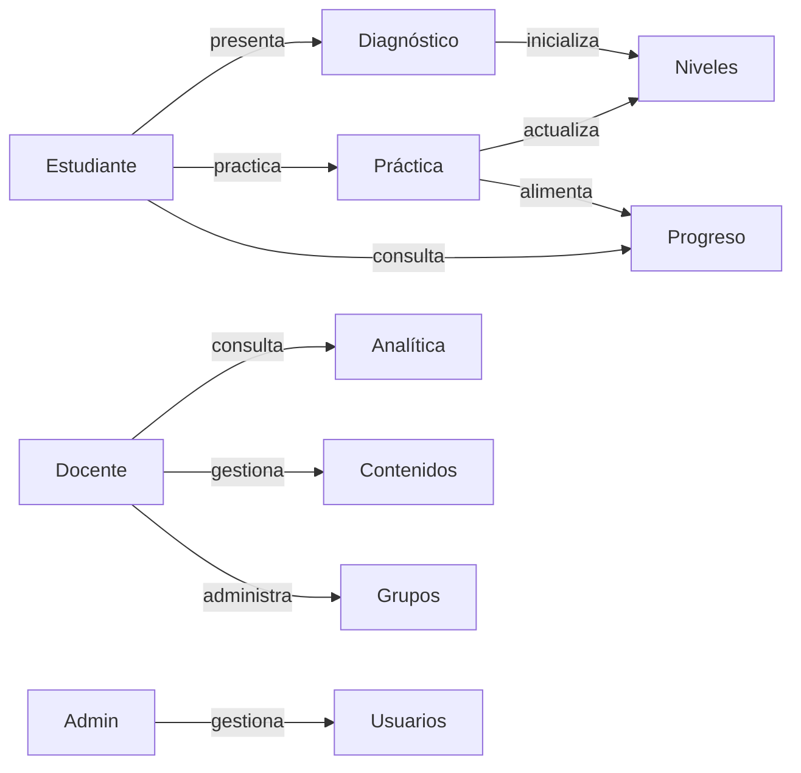
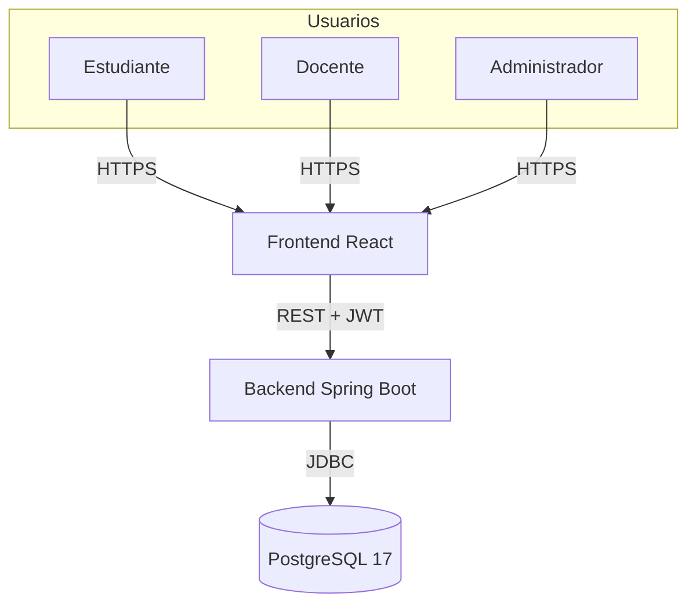
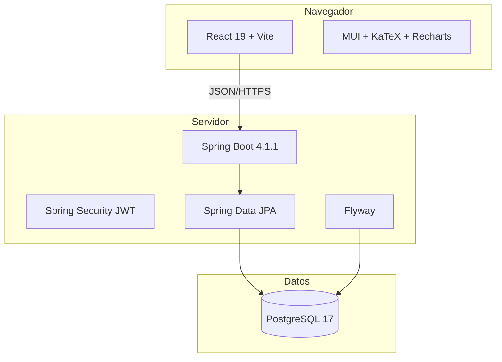
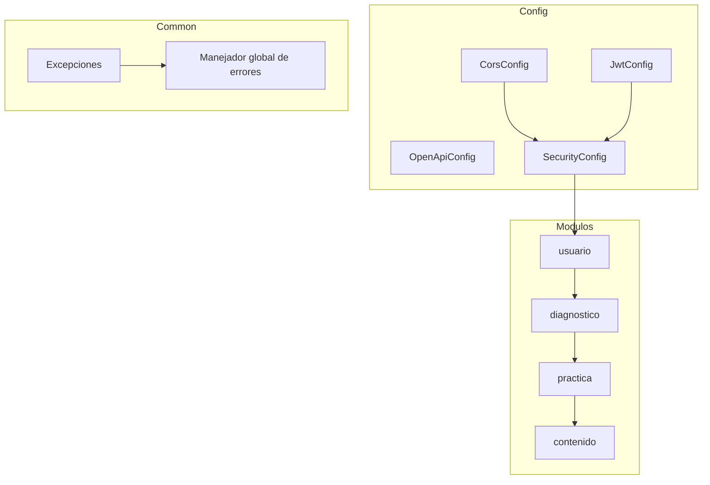
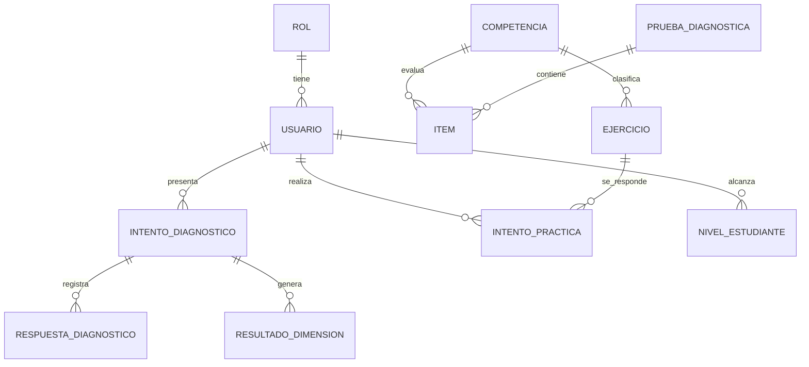

# Documento Maestro de Ingeniería de Software

## Aprendizaje USCO — Plataforma web de diagnóstico y práctica adaptativa de matemáticas

---

## Capítulo 1. Control documental

### 1.1 Portada textual

| Campo | Valor |
|---|---|
| **Nombre del proyecto** | Aprendizaje USCO |
| **Institución** | Universidad Surcolombiana |
| **Programa académico** | Ingeniería de Software — Proyecto Integrador II |
| **Documento** | Documento Maestro de Ingeniería de Software |
| **Versión** | 1.0 |
| **Fecha de elaboración** | 2026-10-26 |
| **Elaborado por** | Agente de documentación (auditoría técnica del repositorio) |
| **Equipo del proyecto** | Jorel Vargas, Juan David Polanco, Nicolás Pérez, Fernando Pérez |
| **Docente** | Irlesa Indira Sánchez Medina |

### 1.2 Historial de versiones

| Versión | Fecha | Autor | Descripción |
|---|---|---|---|
| 1.0 | 2026-10-26 | Agente de documentación | Versión inicial generada a partir de la auditoría técnica del repositorio, los README, el backlog y el modelo de datos. |

### 1.3 Propósito del documento

Este documento consolida el estado real del sistema **Aprendizaje USCO** al 26 de octubre de 2026. Sirve como referencia principal para:

- Comprender la arquitectura, el diseño y la implementación actuales.
- Orientar el desarrollo y mantenimiento del software.
- Apoyar la presentación del Proyecto Integrador II.
- Facilitar la continuación del proyecto como trabajo de grado.
- Integrar nuevos desarrolladores.
- Trazar requisitos, historias de usuario, componentes y casos de prueba.

### 1.4 Audiencia prevista

- Estudiantes del Proyecto Integrador II y trabajo de grado.
- Docente directora y jurados.
- Nuevos desarrolladores o integrantes del semillero.
- Administradores de sistemas y responsables de despliegue.

### 1.5 Convenciones y estructura documental

- Los estados de implementación se clasifican con las categorías definidas en la sección 8 del instructivo de trabajo.
- Los identificadores de requisitos funcionales usan el prefijo `RF-` y los no funcionales `RNF-`.
- Los casos de prueba usan el prefijo `CP-`.
- Las rutas de archivo son relativas a la raíz del repositorio `C:\Users\polan\USCO\SEMESTRE SIETE 2026-2\PROYECTO INTEGRADOR II\Proyecto`.

### 1.6 Fuentes utilizadas

- [Especificación de Requisitos y Comportamiento Funcional](./02_especificacion_requisitos_y_historias_usuario.md)
- [Aseguramiento de Calidad y Plan de Pruebas](./03_aseguramiento_calidad_y_plan_pruebas.md)
- `aprendizaje-usco-backend/README.md`
- `aprendizaje-usco-backend/docs/README-backend.md`
- `aprendizaje-usco-backend/docs/CONTRIBUTING.md`
- `aprendizaje-usco-backend/docs/tareas-y-responsables.md`
- `aprendizaje-usco-backend/docs/base-de-datos/modelo-fisico.md`
- `aprendizaje-usco-backend/docs/code/motor-practica-adaptativa.md`
- `aprendizaje-usco-frontend/README.md`
- `aprendizaje-usco-frontend/docs/README-frontend.md`
- Código fuente de ambos repositorios.
- Archivos de configuración: `pom.xml`, `package.json`, `application.properties`, `compose.yaml`, `.github/workflows/ci.yml`.

---

## Capítulo 2. Resumen ejecutivo

### 2.1 Descripción general

**Aprendizaje USCO** es una plataforma web educativa dirigida a estudiantes de Cálculo Diferencial e Integral de la Universidad Surcolombiana. Su propósito es diagnosticar las competencias matemáticas básicas (algebraicas, lógicas y funcionales), ofrecer práctica adaptativa con retroalimentación inmediata y permitir el seguimiento del progreso por parte de estudiantes y docentes.

### 2.2 Problema que aborda

El proyecto parte de la observación de dificultades en competencias algebraicas, razonamiento lógico y comprensión de funciones, que afectan el desempeño en Cálculo Diferencial e Integral. La plataforma busca fortalecer el aprendizaje autónomo mediante herramientas digitales, evaluación diagnóstica, práctica guiada y retroalimentación formativa.

### 2.3 Solución tecnológica propuesta

Una aplicación web dividida en dos repositorios:

- **Backend:** API REST con Java 21 y Spring Boot 4.1.1, persistencia en PostgreSQL 17 con Flyway, autenticación JWT y seguridad por roles.
- **Frontend:** Aplicación React 19 con Vite 8, MUI, React Router 8, KaTeX para notación matemática y Recharts para gráficos.

### 2.4 Estado actual del producto

| Área | Estado |
|---|---|
| Autenticación y autorización | Implementado en backend y frontend. |
| Prueba diagnóstica | Implementado en backend; interfaz del estudiante es provisional. |
| Práctica adaptativa | Implementado en backend; interfaz del estudiante es provisional. |
| Seguimiento del progreso (estudiante) | Diseñado; no implementado en backend ni frontend. |
| Analítica docente | Diseñado; no implementado en backend ni frontend. |
| Administración de usuarios | Diseñado; no implementado. |
| Gestión de contenidos docente | Modelo de datos preparado; endpoints e interfente pendientes. |
| Despliegue | Configurado para desarrollo local; staging planificado. |

### 2.5 Beneficiarios y actores

- **Estudiantes:** presentan el diagnóstico, practican ejercicios adaptativos y consultan su progreso.
- **Docentes:** administran grupos, revisan desempeño y gestionan actividades.
- **Administradores:** gestionan usuarios, roles y configuración general.

### 2.6 Principales capacidades comprobadas

- Inicio de sesión y registro de estudiantes con correo institucional.
- Emisión y validación de tokens JWT con roles.
- Aplicación, calificación y categorización de la prueba diagnóstica.
- Motor adaptativo de selección de ejercicios basado en reglas.
- Retroalimentación progresiva en práctica.
- Esquema de base de datos versionado con Flyway.
- Integración continua con GitHub Actions.

### 2.7 Limitaciones relevantes

- Las pantallas funcionales principales del frontend aún son provisionales (`PaginaEnConstruccion`).
- No existen endpoints para progreso, analítica, grupos ni administración de usuarios.
- El registro es abierto a cualquier correo estudiantil; el registro por invitación docente está pendiente.
- El despliegue en staging no ha sido verificado en este ejercicio de documentación.

---

## Capítulo 3. Contexto, visión y objetivos

### 3.1 Contexto institucional

La Universidad Surcolombiana, a través del programa de Ingeniería de Software, desarrolla el proyecto **Aprendizaje USCO** como Proyecto Integrador II. La plataforma responde a la necesidad de apoyar el aprendizaje autónomo de matemáticas básicas en asignaturas de cálculo.

### 3.2 Identificación del problema

- Dificultades en competencias algebraicas, razonamiento lógico y comprensión de funciones.
- Necesidad de diagnóstico temprano del nivel de competencias.
- Falta de herramientas digitales de práctica personalizada con retroalimentación inmediata.
- Limitada visibilidad del docente sobre las dificultades individuales y grupales.

### 3.3 Objetivo general del proyecto

Desarrollar una plataforma web que permita diagnosticar, practicar y dar seguimiento a las competencias matemáticas básicas de los estudiantes de Cálculo Diferencial e Integral de la Universidad Surcolombiana.

### 3.4 Objetivos específicos documentados

1. Implementar autenticación y control de acceso por rol.
2. Aplicar una prueba diagnóstica de 24 ítems en tres competencias.
3. Calificar y categorizar el desempeño de los estudiantes.
4. Ofrecer ejercicios de práctica adaptativos por asignatura y nivel.
5. Registrar intentos de práctica con retroalimentación inmediata.
6. Mostrar el progreso del estudiante.
7. Generar indicadores de desempeño para el docente.
8. Permitir la gestión de contenidos y usuarios.

### 3.5 Justificación académica y tecnológica

La plataforma integra principios de aprendizaje adaptativo, retroalimentación formativa y analítica del aprendizaje. Tecnológicamente, usa una arquitectura desacoplada (backend REST + SPA) que permite escalabilidad, pruebas automatizadas e integración continua.

### 3.6 Visión del producto

Ser una herramienta institucional de apoyo al aprendizaje de matemáticas que combine diagnóstico, práctica personalizada y seguimiento docente, mejorando la preparación de los estudiantes para cursos de cálculo.

### 3.7 Indicadores de éxito propuestos

- Cobertura de pruebas automatizadas ≥ 70 % en lógica de negocio.
- Tiempo de respuesta de endpoints críticos < 1 s (p95).
- Puntaje SUS ≥ 68 en validación con usuarios piloto.
- Porcentaje de tareas completadas sin ayuda ≥ 80 % en pruebas de usabilidad.

---

## Capítulo 4. Alcance del producto

### 4.1 Alcance funcional implementado

- Registro e inicio de sesión de estudiantes con correo institucional.
- Control de acceso por rol (ESTUDIANTE, DOCENTE, ADMIN).
- Prueba diagnóstica de 24 ítems con tiempo límite y categorización.
- Banco de 90 ejercicios de práctica (45 Cálculo Diferencial, 45 Cálculo Integral).
- Motor adaptativo de selección de ejercicios.
- Registro de intentos de práctica con retroalimentación progresiva.
- Niveles de dificultad ajustables por racha de aciertos/errores.
- Esquema de base de datos y migraciones versionadas.

### 4.2 Alcance funcional diseñado pero no implementado

- Dashboard de progreso del estudiante.
- Dashboard de desempeño del docente.
- Gestión de grupos y asociación docente-estudiante.
- Administración de usuarios y roles.
- Gestión de actividades y contenidos por parte del docente.
- Historial de resultados paginado.
- Registro de estudiantes por invitación.

### 4.3 Alcance futuro propuesto

- Integración con sistemas académicos de la universidad.
- Reportes exportables.
- Notificaciones y recordatorios.
- Soporte para más asignaturas y competencias.
- Análisis predictivo del riesgo académico.

### 4.4 Funcionalidades expresamente excluidas

- Módulo de pagos o monetización.
- Aplicación móvil nativa (el frontend es web responsive).
- Inteligencia artificial generativa para generar ejercicios (el motor actual es basado en reglas).

### 4.5 Dependencias y restricciones

- PostgreSQL 17 como motor de base de datos.
- Docker Desktop para levantar PostgreSQL en desarrollo.
- Correo institucional `@usco.edu.co` para el registro de estudiantes.
- Navegadores modernos con soporte para ES2022.

---

## Capítulo 5. Actores y procesos de negocio

### 5.1 Tipos de usuario

| Rol | Descripción | Permisos principales |
|---|---|---|
| `ESTUDIANTE` | Usuario que aprende y practica. | Presentar diagnóstico, practicar ejercicios, consultar progreso. |
| `DOCENTE` | Profesor que acompaña grupos. | Ver desempeño de sus grupos, gestionar actividades. |
| `ADMIN` | Administrador de la plataforma. | Gestionar usuarios y roles. |

### 5.2 Procesos académicos relevantes

1. **Diagnóstico inicial:** el estudiante presenta una prueba de 24 ítems que determina su nivel por competencia.
2. **Práctica adaptativa:** el sistema selecciona ejercicios según el nivel y el desempeño reciente.
3. **Retroalimentación:** tras cada respuesta se ofrece pista o explicación según el número de intento.
4. **Seguimiento:** el estudiante consulta su avance; el docente consulta el desempeño grupal.
5. **Gestión de contenidos:** el docente crea, edita y activa ejercicios.

### 5.3 Relaciones entre actores, procesos y módulos



---

## Capítulo 6. Arquitectura de software

### 6.1 Estilo arquitectónico

Arquitectura **cliente-servidor desacoplada** con una Single Page Application (SPA) en el frontend que consume una API REST stateless en el backend. El backend sigue una organización por **módulos funcionales con capas internas** (controller, service, repository, dto, model).

### 6.2 Diagrama de contexto



### 6.3 Diagrama de contenedores



### 6.4 Diagrama de componentes del backend



### 6.5 Decisiones arquitectónicas

| Decisión | Justificación |
|---|---|
| Separación frontend/backend | Permite equipos independientes, reutilización de la API y despliegue escalable. |
| JWT stateless | Facilita escalabilidad horizontal sin sesiones en servidor. |
| Organización por módulos | Reduce conflictos de merge y mejora la cohesión. |
| Flyway para migraciones | Controla el esquema de base de datos de forma versionada y reversible. |
| Hibernate `ddl-auto=validate` | Garantiza que el modelo Java coincida con el esquema gestionado por Flyway. |

---

## Capítulo 7. Diseño técnico detallado

### 7.1 Estructura de directorios del backend

```
aprendizaje-usco-backend/
├── src/main/java/co/edu/usco/aprendizaje_usco/
│   ├── config/         # CORS, OpenAPI, beans generales
│   ├── security/       # JWT, SecurityConfig, UserDetailsService
│   ├── common/         # Excepciones y manejador global de errores
│   └── modulos/
│       ├── usuario/    # AuthController, AuthService, DTOs, entidades
│       ├── diagnostico/# DiagnosticoController, DiagnosticoService
│       ├── practica/   # PracticaController, motor adaptativo, niveles
│       └── contenido/  # Entidades de contenido y ejercicio
├── src/main/resources/
│   ├── db/migration/   # Migraciones Flyway
│   ├── db/dev-data/    # Datos de prueba (perfil dev)
│   ├── application.properties
│   └── application-dev.properties
└── pom.xml
```

### 7.2 Estructura de directorios del frontend

```
aprendizaje-usco-frontend/
├── src/
│   ├── api/            # Clientes HTTP por módulo
│   ├── components/     # Componentes reutilizables (MathText, etc.)
│   ├── context/        # AuthContext
│   ├── features/       # Páginas organizadas por módulo
│   ├── layouts/        # Layouts por rol
│   ├── routes/         # AppRouter, ProtectedRoute
│   ├── theme/          # Tema institucional MUI
│   └── test/           # Utilidades de pruebas
├── package.json
└── vite.config.js
```

### 7.3 Patrones de diseño identificados

- **DTO (Data Transfer Object):** los controladores reciben y devuelven DTOs, nunca entidades.
- **Repository:** Spring Data JPA para acceso a datos.
- **Dependency Injection:** inyección de servicios y repositorios por constructor.
- **MVC/MVP en frontend:** componentes de presentación, hooks y servicios de API separados.

### 7.4 Puntos de extensión

- Nuevas competencias se agregan por migración de datos sin cambiar código.
- Nuevos niveles y umbrales son configurables en `application.properties`.
- Nuevas asignaturas requieren actualizar `app.practica.asignaturas`.

### 7.5 Deuda técnica

- Gran parte de las pantallas del frontend son provisionales.
- No existen endpoints para progreso, analítica, grupos ni administración.
- Falta implementar el registro por invitación docente.
- Falta completar pruebas de rendimiento y seguridad.

---

## Capítulo 8. Módulos funcionales

### 8.1 Módulo de autenticación y gestión de usuarios

| Campo | Valor |
|---|---|
| **Identificador** | MOD-AUT |
| **Propósito** | Permitir el inicio de sesión y el registro de estudiantes. |
| **Usuarios** | Todos los roles. |
| **Funcionalidades** | Login, registro de estudiantes, consulta de usuario actual. |
| **Endpoints** | `POST /api/auth/login`, `POST /api/auth/registro`, `GET /api/auth/me` |
| **Componentes frontend** | `LoginPage.jsx`, `RegistroPage.jsx`, `AuthContext.jsx` |
| **Entidades** | `rol`, `usuario` |
| **Estado** | Implementado y verificado (backend y frontend). |

### 8.2 Módulo de diagnóstico

| Campo | Valor |
|---|---|
| **Identificador** | MOD-DIA |
| **Propósito** | Aplicar la prueba diagnóstica de competencias matemáticas. |
| **Usuarios** | Estudiante. |
| **Funcionalidades** | Iniciar/retomar prueba, responder ítems, finalizar, consultar resultado. |
| **Endpoints** | `POST /api/diagnosticos/intentos`, `GET /api/diagnosticos/intentos/actual`, `GET /api/diagnosticos/intentos/{id}`, `PUT /api/diagnosticos/intentos/{id}/respuestas/{itemId}`, `POST /api/diagnosticos/intentos/{id}/finalizar`, `GET /api/diagnosticos/intentos/{id}/resultado` |
| **Componentes frontend** | `DiagnosticoPage.jsx` (provisional). |
| **Entidades** | `prueba_diagnostica`, `item`, `opcion`, `intento_diagnostico`, `respuesta_diagnostico`, `resultado_dimension` |
| **Estado** | Implementado en backend; interfaz del estudiante pendiente. |

### 8.3 Módulo de práctica adaptativa

| Campo | Valor |
|---|---|
| **Identificador** | MOD-PRA |
| **Propósito** | Seleccionar ejercicios adaptativos y registrar intentos con retroalimentación. |
| **Usuarios** | Estudiante. |
| **Funcionalidades** | Obtener siguiente ejercicio, enviar respuesta, recibir retroalimentación, ajustar nivel. |
| **Endpoints** | `GET /api/practica/siguiente`, `POST /api/practica/intentos` |
| **Componentes frontend** | `PracticaPage.jsx` (provisional). |
| **Entidades** | `contenido`, `ejercicio`, `opcion_ejercicio`, `intento_practica`, `nivel_estudiante`, `historial_nivel` |
| **Estado** | Implementado en backend; interfaz del estudiante pendiente. |

### 8.4 Módulo de contenidos

| Campo | Valor |
|---|---|
| **Identificador** | MOD-CON |
| **Propósito** | Agrupar y almacenar ejercicios de práctica. |
| **Usuarios** | Docente (diseñado), estudiante (consume). |
| **Funcionalidades** | Modelo de datos para contenidos y ejercicios; semilla de 90 ejercicios. |
| **Endpoints** | Ninguno implementado aún. |
| **Componentes frontend** | `ActividadesPage.jsx` (provisional). |
| **Entidades** | `contenido`, `ejercicio`, `opcion_ejercicio` |
| **Estado** | Modelo implementado; CRUD docente pendiente. |

### 8.5 Módulos pendientes

| Módulo | Identificador | Estado |
|---|---|---|
| Seguimiento del progreso | MOD-PRO | Diseñado, no implementado. |
| Analítica docente | MOD-ANA | Diseñado, no implementado. |
| Administración de usuarios | MOD-ADM | Diseñado, no implementado. |
| Grupos e invitaciones | MOD-GRU | Diseñado, no implementado. |

---

## Capítulo 9. Diseño de interfaces y experiencia de usuario

### 9.1 Inventario de pantallas

| Ruta | Rol | Estado |
|---|---|---|
| `/login` | Público | Implementada. |
| `/registro` | Público | Implementada. |
| `/estudiante` | Estudiante | Provisional. |
| `/estudiante/diagnostico` | Estudiante | Provisional. |
| `/estudiante/practica` | Estudiante | Provisional. |
| `/estudiante/progreso` | Estudiante | Provisional. |
| `/docente` | Docente | Provisional. |
| `/docente/estudiantes` | Docente | Provisional. |
| `/docente/actividades` | Docente | Provisional. |
| `/docente/reportes` | Docente | Provisional. |
| `/admin` | Admin | Provisional. |
| `/admin/usuarios` | Admin | Provisional. |
| `/admin/roles` | Admin | Provisional. |
| `/no-autorizado` | Cualquiera | Implementada. |
| `/dev/mathtext` | Desarrollo | Implementada. |

### 9.2 Navegación

La navegación se define en `src/routes/AppRouter.jsx` y los menús en `src/routes/navegacion.js`. Cada rol tiene su propio layout con menú lateral responsive.

### 9.3 Componentes reutilizables

- `MathText.jsx`: renderiza notación matemática con KaTeX.
- `PaginaEnConstruccion.jsx`: pantalla provisional.
- `CargandoPagina.jsx`: indicador de carga.
- `MarcaUsco.jsx`: marca institucional.

### 9.4 Accesibilidad

- Uso de labels visibles y asociados.
- Errores enlazados con `aria-describedby`.
- Foco al primer campo inválido.
- Navegación por teclado.
- Imágenes con texto alternativo.
- Contraste validado en tema institucional.

---

## Capítulo 10. Modelo y gestión de datos

### 10.1 Modelo conceptual



### 10.2 Motor de base de datos

PostgreSQL 17. El esquema se gestiona exclusivamente con Flyway; Hibernate solo valida (`ddl-auto=validate`).

### 10.3 Migraciones identificadas

| Migración | Descripción |
|---|---|
| `V1__esquema_inicial.sql` | Tablas `rol`, `usuario`, `competencia`. |
| `V2__datos_base_roles_competencias.sql` | Roles y competencias semilla. |
| `V3__esquema_diagnostico.sql` | Tablas de la prueba diagnóstica. |
| `V4__datos_prueba_diagnostica.sql` | 24 ítems y opciones de la prueba v2.0. |
| `V5__esquema_practica.sql` | Tablas de práctica adaptativa. |
| `V6__datos_ejercicios_semilla.sql` | 90 ejercicios semilla. |
| `V7__crear_grupos_docentes_estudiantes.sql` | Tablas de grupos y asociación docente-estudiante. |
| `R__usuarios_de_prueba.sql` | Usuarios de prueba (solo perfil dev). |

### 10.4 Datos personales y académicos

Se almacenan nombres, apellidos, correo institucional, programa académico, rol, estado, resultados de diagnóstico e intentos de práctica. Los datos deben tratarse conforme a la Ley 1581 de 2012.

---

## Capítulo 11. Tecnologías, herramientas y dependencias

### 11.1 Backend

| Tecnología | Versión | Propósito |
|---|---|---|
| Java | 21 | Lenguaje de programación. |
| Spring Boot | 4.1.1 | Framework de aplicación. |
| Spring Security | 4.1.1 | Autenticación y autorización. |
| Spring Data JPA | 4.1.1 | Persistencia. |
| Flyway | (starter) | Migraciones de base de datos. |
| PostgreSQL | 17 | Base de datos relacional. |
| Lombok | (starter) | Reducción de boilerplate. |
| Springdoc OpenAPI | 3.0.3 | Documentación Swagger UI. |
| Testcontainers | (starter) | Pruebas de integración con PostgreSQL. |

### 11.2 Frontend

| Tecnología | Versión | Propósito |
|---|---|---|
| React | 19.2.8 | Biblioteca de interfaz. |
| Vite | 8.3.0 | Build y servidor de desarrollo. |
| React Router | 8.4.0 | Enrutamiento. |
| MUI | 9.4.0 | Componentes visuales. |
| Axios | 1.20.0 | Cliente HTTP. |
| KaTeX | 0.18.9 | Renderizado de matemáticas. |
| Recharts | 3.10.1 | Gráficos. |
| Vitest | 4.1.12 | Pruebas unitarias. |
| ESLint / Prettier | 10.10.0 / 3.9.9 | Calidad de código. |

### 11.3 Infraestructura

| Herramienta | Uso |
|---|---|
| GitHub | Control de versiones. |
| GitHub Actions | Integración continua. |
| Docker / Docker Compose | Entorno de desarrollo local. |
| Jira | Gestión de tareas (referenciado en documentación). |

---

## Capítulo 12. Interfaces e integración

### 12.1 API REST

Toda la comunicación entre frontend y backend se realiza mediante JSON sobre HTTPS (HTTP en desarrollo). Los endpoints se documentan con OpenAPI/Swagger en `/swagger-ui.html`.

### 12.2 Contratos principales

- Autenticación: `POST /api/auth/login` devuelve token JWT y datos de usuario.
- Registro: `POST /api/auth/registro` crea estudiantes.
- Diagnóstico: endpoints bajo `/api/diagnosticos/intentos`.
- Práctica: endpoints bajo `/api/practica`.

### 12.3 Formatos de datos

- JWT con claims `sub`, `correo`, `rol`.
- Respuestas de error estándar: `{ timestamp, status, message, path }`.

---

## Capítulo 13. Seguridad y protección de datos

### 13.1 Activos que requieren protección

- Credenciales de usuario.
- Tokens JWT.
- Datos personales de estudiantes.
- Resultados de diagnóstico e intentos de práctica.
- Claves de respuesta de ítems y ejercicios.

### 13.2 Controles implementados

- Contraseñas almacenadas con BCrypt.
- Autenticación JWT stateless (HS256).
- Autorización por rol con `@PreAuthorize`.
- CORS configurado por variable de entorno.
- Validación de entradas con Bean Validation.
- Manejador global de errores que no expone stack traces.
- Claves de respuesta nunca enviadas al frontend.

### 13.3 Controles pendientes

- Límite de intentos de login.
- Invalidación inmediata de tokens al desactivar usuario.
- Auditoría de acceso.
- Pruebas de seguridad automatizadas.
- Registro por invitación.

### 13.4 Gestión de secretos

- `JWT_SECRET` se define fuera del repositorio.
- El perfil `dev` usa una clave pública conocida solo para desarrollo local.
- `.env` y `.env.development` están en `.gitignore`.

---

## Capítulo 14. Requisitos no funcionales y atributos de calidad

| ID | Atributo | Descripción | Estado |
|---|---|---|---|
| RNF-01 | Usabilidad | ≥ 80 % de tareas completadas sin ayuda; SUS ≥ 68. | Propuesto. |
| RNF-02 | Rendimiento | p95 < 1 s en endpoints críticos con 30 usuarios concurrentes. | Propuesto. |
| RNF-03 | Seguridad | Autenticación JWT y autorización por rol. | Implementado. |
| RNF-04 | Seguridad | Sin duplicación de intentos bajo envíos concurrentes. | Implementado (idempotencia). |
| RNF-05 | Accesibilidad | WCAG 2.1 AA en pantallas principales. | Parcialmente implementado. |
| RNF-08 | Mantenibilidad | Organización por módulos funcionales. | Implementado. |
| RNF-09 | Escalabilidad | Nuevas competencias sin cambio de código. | Implementado. |
| RNF-10 | Fiabilidad | Registro idempotente de intentos. | Implementado. |

---

## Capítulo 15. Despliegue y operación

### 15.1 Entornos

- **Desarrollo local:** backend en puerto 8080, frontend en 5173, PostgreSQL en 5433 (Docker).
- **Staging:** planificado, no verificado.
- **Producción:** planificado, no verificado.

### 15.2 Inicio local del backend

```bash
cd aprendizaje-usco-backend
copy .env.template .env
mvnw.cmd spring-boot:run
```

### 15.3 Inicio local del frontend

```bash
cd aprendizaje-usco-frontend
copy .env.example .env.development
npm install
npm run dev
```

### 15.4 Variables de entorno principales

| Variable | Descripción |
|---|---|
| `JWT_SECRET` | Clave para firmar tokens. |
| `JWT_EXPIRATION_MINUTES` | Duración del token. |
| `CORS_ORIGINS` | Orígenes permitidos. |
| `SPRING_DATASOURCE_URL` | URL de conexión a PostgreSQL. |
| `VITE_API_URL` | URL base de la API en el frontend. |

---

## Capítulo 16. Ingeniería de desarrollo y mantenibilidad

### 16.1 Flujo de trabajo

- Rama `develop` por defecto.
- Ramas `feature/AU-<n>-descripcion`.
- Pull requests con al menos una aprobación y CI en verde.
- Squash and merge.

### 16.2 Convenciones

- Commits con Conventional Commits en español e imperativo.
- Backend: paquetes y clases en español.
- Frontend: componentes en `PascalCase`, hooks con prefijo `use`.

### 16.3 Deuda técnica

- Pantallas provisionales del frontend.
- Módulos de progreso, analítica, administración y grupos no implementados.
- Falta hardening de seguridad.

---

## Capítulo 17. Riesgos, limitaciones y decisiones técnicas

| Riesgo | Probabilidad | Impacto | Mitigación | Estado |
|---|---|---|---|---|
| Pantallas provisionales retrasan la validación con usuarios. | Alta | Alto | Priorizar implementación de diagnóstico y práctica. | Activo. |
| Fuga de claves de respuesta en frontend. | Baja | Alto | Backend nunca envía `esCorrecta`. | Controlado. |
| Escalabilidad limitada sin Docker en producción. | Media | Medio | Preparar Dockerfile y despliegue documentado. | Pendiente. |
| Dependencia de Docker para pruebas. | Media | Medio | Documentar requisitos de entorno. | Aceptado. |

---

## Capítulo 18. Evolución del producto

### 18.1 Mejoras inmediatas

1. Implementar la interfaz completa de la prueba diagnóstica.
2. Implementar la interfaz de práctica adaptativa.
3. Desarrollar el dashboard de progreso del estudiante.

### 18.2 Mejoras de mediano plazo

1. Dashboard docente con analítica de grupo.
2. Gestión de grupos e invitaciones.
3. Administración de usuarios y roles.
4. Gestión de contenidos por parte del docente.

### 18.3 Funcionalidades futuras

1. Reportes exportables.
2. Integración con sistemas institucionales.
3. Notificaciones y recordatorios.
4. Soporte para nuevas asignaturas.

---

## Capítulo 19. Trazabilidad documental

| Objetivo | Requisito | Historia | Módulo | Componente | Entidad | Endpoint |
|---|---|---|---|---|---|---|
| Autenticar usuarios | RF-01 | #20 | MOD-AUT | AuthController | usuario | `/api/auth/login` |
| Registrar estudiantes | RF-01 | #20 | MOD-AUT | AuthController | usuario | `/api/auth/registro` |
| Control de acceso | RF-01 / RNF-03 | #28 | MOD-AUT | SecurityConfig | rol | — |
| Aplicar diagnóstico | RF-02 | #51 | MOD-DIA | DiagnosticoController | intento_diagnostico | `/api/diagnosticos/intentos` |
| Calcular puntaje | RF-03 | #57 | MOD-DIA | DiagnosticoService | resultado_dimension | — |
| Categorizar desempeño | RF-04 | #61 | MOD-DIA | DiagnosticoService | intento_diagnostico | `/api/diagnosticos/intentos/{id}/resultado` |
| Seleccionar ejercicio | RF-05 | #90 | MOD-PRA | PracticaController | ejercicio | `/api/practica/siguiente` |
| Retroalimentación | RF-07 | #110 | MOD-PRA | FeedbackService | intento_practica | `/api/practica/intentos` |
| Registrar intentos | RF-08 | #114 | MOD-PRA | PracticaService | intento_practica | `/api/practica/intentos` |
| Progreso estudiante | RF-09 | #119 | MOD-PRO | — | — | — |
| Analítica docente | RF-10 / RF-11 | #124 / #131 | MOD-ANA | — | — | — |
| Administración | RF-13 | #136 | MOD-ADM | — | — | — |

---

## Capítulo 20. Glosario y referencias

### 20.1 Glosario

| Término | Definición |
|---|---|
| **Prueba diagnóstica** | Instrumento de 24 ítems que evalúa competencias algebraicas, lógicas y funcionales. |
| **Motor adaptativo** | Algoritmo basado en reglas que selecciona el siguiente ejercicio según el desempeño. |
| **Nivel de práctica** | Dificultad del ejercicio ofrecido (1 a 3). |
| **Retroalimentación progresiva** | Pista en primer fallo, explicación completa en segundo fallo. |
| **Flyway** | Herramienta de migración de esquemas de base de datos. |

### 20.2 Siglas

| Sigla | Significado |
|---|---|
| JWT | JSON Web Token |
| SPA | Single Page Application |
| DTO | Data Transfer Object |
| CORS | Cross-Origin Resource Sharing |
| SUS | System Usability Scale |
| WCAG | Web Content Accessibility Guidelines |

### 20.3 Referencias del repositorio

- `aprendizaje-usco-backend/docs/README-backend.md`
- `aprendizaje-usco-backend/docs/base-de-datos/modelo-fisico.md`
- `aprendizaje-usco-backend/docs/code/motor-practica-adaptativa.md`
- `aprendizaje-usco-backend/docs/tareas-y-responsables.md`
- `aprendizaje-usco-frontend/docs/README-frontend.md`

---

*Fin del Documento Maestro de Ingeniería de Software*
