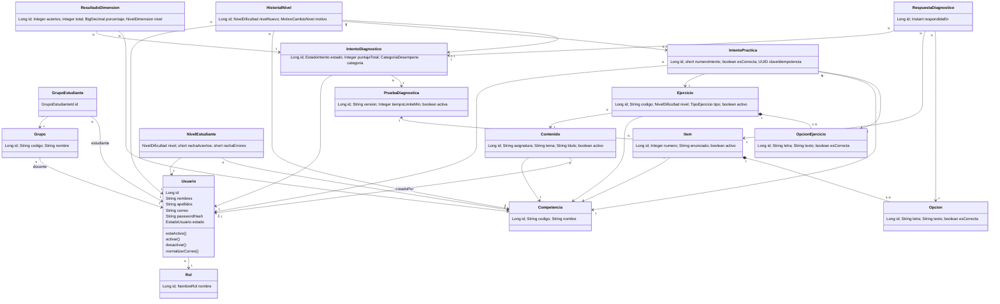
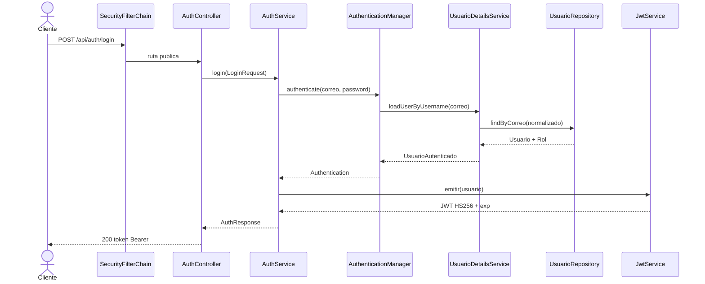
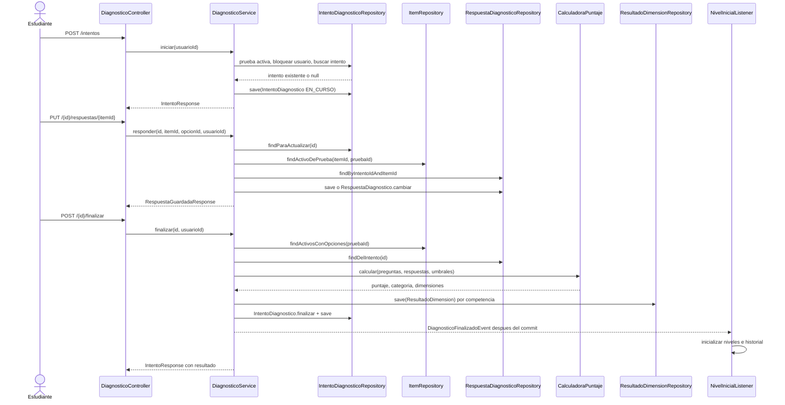
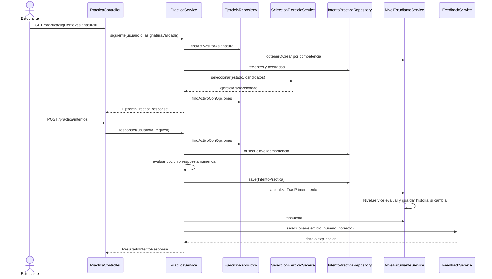
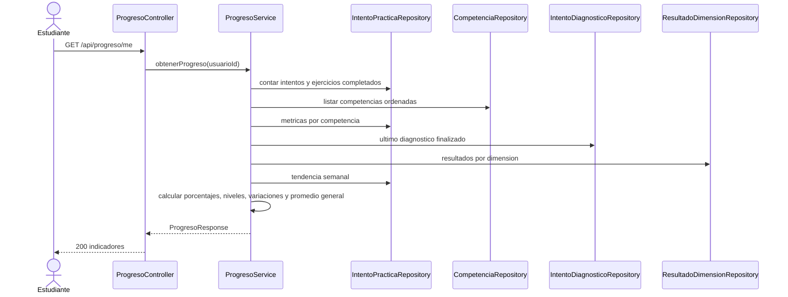

# Documentacion UML del backend de Aprendizaje USCO

## 1. Alcance y criterio de evidencia

Este documento describe el backend que existe en `src/main/java` y las
relaciones de base de datos definidas en las migraciones Flyway. No convierte
las historias del backlog en funcionalidades: una funcionalidad se marca como
implementada solamente cuando tiene clases y rutas ejecutables en el codigo
actual.

Tecnologias observadas:

- Java 21, Spring Boot, Spring Web MVC y Spring Data JPA.
- Spring Security como OAuth2 Resource Server con JWT HS256.
- PostgreSQL y Flyway.
- DTOs Java `record` para los contratos HTTP.

Los controladores no devuelven entidades JPA directamente. Construyen o
reciben DTOs, y las entidades se transforman en los servicios.

## 2. Entidades principales, atributos, metodos y relaciones

### 2.1 Usuarios y acceso

| Clase | Atributos relevantes | Metodos de dominio | Relaciones reales |
|---|---|---|---|
| `Usuario` | `id`, `nombres`, `apellidos`, `correo`, `passwordHash`, `rol`, `programaAcademico`, `estado`, `creadoEn`, `actualizadoEn` | `normalizarCorreo`, `estaActivo`, `activar`, `desactivar`, `setCorreo` | `N:1 Rol`; es referenciado por grupos, contenidos, ejercicios, intentos, niveles e invitaciones |
| `Rol` | `id`, `nombre` (`ESTUDIANTE`, `DOCENTE`, `ADMIN`) | getters, `equals`, `hashCode` | `1:N Usuario` a nivel de FK |
| `Grupo` | `id`, `codigo`, `nombre`, `docente`, `creadoEn` | constructor normalizador | `N:1 Usuario` como docente |
| `GrupoEstudiante` | clave compuesta `grupoId/estudianteId`, `grupo`, `estudiante`, `creadoEn` | constructor | une `Grupo` y `Usuario` estudiante |
| `Invitacion` | `id`, `grupo`, `correo`, `nombres`, `apellidos`, `tokenHash`, `venceEn`, `usadaEn`, fechas | `renovar`, `marcarUsada`, `estaUsada`, `estaVigente` | `N:1 Grupo`; al registrarse el estudiante, el servicio consume la invitacion y crea la inscripcion en `GrupoEstudiante` |

`Usuario` normaliza el correo y comienza en estado `ACTIVO`. El hash de
contrasena no se expone en DTOs ni en `toString`.

### 2.2 Catalogo, contenidos y ejercicios

| Clase | Atributos relevantes | Metodos de dominio | Relaciones reales |
|---|---|---|---|
| `Competencia` | `id`, `codigo`, `nombre`, `descripcion` | getters | es referenciada por contenidos, ejercicios, items, resultados y niveles |
| `Contenido` | `id`, `competencia`, `asignatura`, `tema`, `titulo`, `descripcion`, `activo`, `creadoPor`, fechas | `actualizar`, `activar`, `desactivar` | `N:1 Competencia`; `N:1 Usuario` opcional como creador |
| `Ejercicio` | `id`, `contenido`, `competencia`, `codigo`, `nivel`, `tipo`, `enunciado`, `respuestaNumerica`, `tolerancia`, `pista`, `explicacion`, `errorComun`, `activo`, auditoria | `agregarOpcion`, `reemplazarOpciones`, `actualizarContenido`, `actualizarTipoRespuesta`, `actualizarDatos`, `opcionCorrecta`, `opcion`, `esNumerico`, `activar`, `desactivar` | `N:1 Contenido`, `N:1 Competencia`, creadores opcionales, `1:N OpcionEjercicio` |
| `OpcionEjercicio` | `id`, `ejercicio`, `letra`, `texto`, `esCorrecta` | ninguno adicional | `N:1 Ejercicio` |

Aunque `Ejercicio` guarda una FK a `Competencia`, esa competencia se sincroniza
desde `Contenido` en `actualizarContenido`; no es una relación calculada solo
en memoria.

### 2.3 Diagnostico

| Clase | Atributos relevantes | Metodos de dominio | Relaciones reales |
|---|---|---|---|
| `PruebaDiagnostica` | `id`, `nombre`, `version`, `tiempoLimiteMin`, `activa`, `creadoEn` | `getTiempoLimite` | es referenciada por `Item` e `IntentoDiagnostico` |
| `Item` | `id`, `prueba`, `numero`, `enunciado`, `competencia`, imagen, activo, opciones | `opcionCorrecta`, `opcion` | `N:1 PruebaDiagnostica`, `N:1 Competencia`, `1:N Opcion` |
| `Opcion` | `id`, `item`, `letra`, `texto`, `esCorrecta` | ninguno adicional | `N:1 Item` |
| `IntentoDiagnostico` | `id`, `usuario`, `prueba`, `estado`, inicio/fin, `finalizadoPorTiempo`, `puntajeTotal`, `categoria` | `estaEnCurso`, `perteneceA`, `venceEn`, `estaVencido`, `segundosRestantes`, `finalizar` | `N:1 Usuario`, `N:1 PruebaDiagnostica`; es referenciado por respuestas, resultados y cambios de nivel |
| `RespuestaDiagnostico` | `id`, `intento`, `item`, `opcion`, `respondidaEn` | `cambiar` | `N:1 IntentoDiagnostico`, `N:1 Item`, `N:1 Opcion` |
| `ResultadoDimension` | `id`, `intento`, `competencia`, `aciertos`, `total`, `porcentaje`, `nivel` | ninguno adicional | `N:1 IntentoDiagnostico`, `N:1 Competencia` |

No existe una clase `Pregunta`: en el modelo persistente la pregunta del
diagnostico es `Item`. Tampoco existe un `Resultado` general: el resultado
global se conserva en `IntentoDiagnostico` y el desglose por competencia en
`ResultadoDimension`.

### 2.4 Practica y progreso

| Clase | Atributos relevantes | Metodos de dominio | Relaciones reales |
|---|---|---|---|
| `IntentoPractica` | `id`, `usuario`, `ejercicio`, `competencia`, `nivelEjercicio`, `numeroIntento`, opcion o respuesta numerica, `esCorrecta`, `tiempoSeg`, `pistaUsada`, `claveIdempotencia`, `creadoEn` | `esPrimerIntento` | `N:1 Usuario`, `N:1 Ejercicio`, `N:1 Competencia`, `N:1 OpcionEjercicio` opcional |
| `NivelEstudiante` | clave compuesta usuario/competencia, `usuario`, `competencia`, `nivel`, rachas de aciertos/errores, fecha | `actualizar` | `N:1 Usuario`, `N:1 Competencia` |
| `HistorialNivel` | `usuario`, `competencia`, nivel anterior/nuevo, motivo, intento de practica opcional, intento diagnostico opcional, fecha | ninguno adicional | referencia el cambio de nivel y su origen |

El progreso no se almacena como una entidad `Progreso`. `ProgresoService`
calcula sus indicadores leyendo `IntentoPractica`, `ResultadoDimension`,
`IntentoDiagnostico` y el catalogo de `Competencia`.

### 2.5 Diagrama de clases del dominio

## 3. Controladores, servicios y repositorios existentes

### 3.1 Controladores HTTP

| Controlador | Base y rutas implementadas | Autorizacion |
|---|---|---|
| `AuthController` | `/api/auth/login`, `/registro`, `/invitacion`, `/me` | login, registro e invitacion publicos; `/me` autenticado |
| `DiagnosticoController` | `/api/diagnosticos/intentos`: iniciar, actual, obtener, resultado, responder, finalizar | ESTUDIANTE |
| `PracticaController` | `/api/practica/siguiente`, `/api/practica/intentos` | ESTUDIANTE |
| `ProgresoController` | `/api/progreso/me` | ESTUDIANTE |
| `HistorialController` | `/api/historial` | ESTUDIANTE o DOCENTE |
| `ContenidoController` | CRUD `/api/contenidos` | DOCENTE |
| `EjercicioController` | CRUD `/api/ejercicios` | DOCENTE |
| `AdminActividadesController` | resumen/listado administrativo de contenidos y ejercicios | ADMIN |
| `AnaliticaGrupoController` | `/api/analitica/grupos/{grupoId}` y detalle de estudiante | DOCENTE |
| `GrupoController` | crear/listar grupos, listar e inscribir estudiantes | DOCENTE o ADMIN segun operacion |
| `InvitacionController` | listar, cargar lote y reenviar invitaciones | DOCENTE o ADMIN |
| `AdminUsuarioController` | listar, crear, editar y cambiar estado de usuarios | ADMIN |
| `AdminResumenController` | resumen administrativo | ADMIN |
| `PingController` | `/api/ping/{rol}` | autoridad del rol solicitado |

### 3.2 Servicios y metodos publicos relevantes

| Servicio | Responsabilidad y metodos |
|---|---|
| `AuthService` | `login`, `registrar`, `usuarioActual` |
| `InvitacionService` | `crearLote`, `listar`, `reenviar`, `obtenerPublica`, `validarParaRegistro`, `registrar` |
| `CorreoInvitacionService` | `enviar` |
| `GrupoService` | `crear`, `listar`, `estudiantes`, `inscribir`, `esDocenteDe`, `obtenerGrupoDelDocente` |
| `AdminUsuarioService` | `resumen`, `listar`, `crear`, `actualizar`, `cambiarEstado` |
| `ContenidoService` | `listar`, `crear`, `actualizar`, `cambiarEstado`, `eliminar` |
| `EjercicioService` | `listar`, `crear`, `actualizar`, `cambiarEstado`, `eliminar` |
| `AdminActividadesService` | `listar` |
| `DiagnosticoService` | `iniciar`, `actual`, `obtener`, `resultado`, `responder`, `finalizar`, `finalizarSiVencido` |
| `CalculadoraPuntaje` | `calcular` como logica pura de calificacion |
| `BarridoIntentosVencidos` | `ejecutar` para cerrar intentos vencidos |
| `PracticaService` | `siguiente`, `responder` |
| `SeleccionEjercicioService` | `seleccionar` de forma determinista |
| `FeedbackService` | `seleccionar` pista/explicacion |
| `NivelEstudianteService` | `inicializarDesdeResultados`, `obtenerOCrear`, `actualizarTrasPrimerIntento`, `respuesta` |
| `NivelService` | evaluacion pura de cambio de nivel |
| `AsignaturaValidator` | valida la asignatura solicitada |
| `ProgresoService` | `obtenerProgreso` |
| `HistorialService` | `consultar` |
| `IndicadoresGrupoService` | `resumen`, `detalle` |

### 3.3 Repositorios existentes

Repositorios JPA: `UsuarioRepository`, `RolRepository`, `InvitacionRepository`,
`GrupoRepository`, `GrupoEstudianteRepository`, `CompetenciaRepository`,
`ContenidoRepository`, `EjercicioRepository`, `PruebaDiagnosticaRepository`,
`ItemRepository`, `IntentoDiagnosticoRepository`,
`RespuestaDiagnosticoRepository`, `ResultadoDimensionRepository`,
`IntentoPracticaRepository`, `NivelEstudianteRepository` y
`HistorialNivelRepository`.

Consultas importantes:

- `UsuarioRepository.findByCorreo` carga el rol mediante `EntityGraph`;
  `findParaBloquear` usa bloqueo pesimista.
- `PruebaDiagnosticaRepository.findFirstByActivaTrue` obtiene la prueba activa.
- `IntentoDiagnosticoRepository.findParaActualizar` bloquea el intento para
  finalizarlo o guardar respuestas de forma consistente.
- `ItemRepository.findActivosConOpciones` y `findActivoDePrueba` cargan
  preguntas y opciones.
- `EjercicioRepository.findActivosPorAsignatura` y
  `findActivoConOpciones` alimentan la practica.
- `IntentoPracticaRepository` consulta idempotencia, intentos previos,
  aciertos, metricas por competencia y tendencia semanal.
- `HistorialRepository` es un repositorio JDBC, no JPA: combina con `UNION ALL`
  diagnósticos finalizados e intentos de práctica.
- `AnaliticaGrupoRepository` concentra las consultas SQL para los indicadores
  del docente.

## 4. Flujo completo de autenticacion

### 4.1 Login

1. El cliente envia `POST /api/auth/login` con `LoginRequest`.
2. `SecurityConfig.filterChain` permite la ruta publica e ignora un bearer
   token residual en login y registro.
3. `AuthController.login` delega en `AuthService.login`.
4. `AuthService` llama a `AuthenticationManager.authenticate`.
5. `DaoAuthenticationProvider` llama a
   `UsuarioDetailsService.loadUserByUsername`.
6. `UsuarioDetailsService` normaliza el correo y consulta
   `UsuarioRepository.findByCorreo`.
7. El usuario debe existir y estar `ACTIVO`; BCrypt compara la contrasena.
8. Si falla cualquier credencial, `AuthService` transforma la excepcion en
   `NoAutenticadoException` con mensaje generico.
9. Si es correcto, `JwtService.emitir` crea el JWT HS256 con `sub`, `correo`,
   `rol`, `iat` y `exp`.
10. `AuthService` devuelve `AuthResponse` con token Bearer, expiracion y
    `UsuarioResponse`.

### 4.2 Peticiones autenticadas

1. `SecurityConfig` recibe `Authorization: Bearer`.
2. El resource server valida firma, estructura y expiracion con el decoder
   configurado en `JwtConfig`.
3. `JwtRoleConverter` toma el claim `rol`, acepta solo los tres roles y crea
   `ROLE_ESTUDIANTE`, `ROLE_DOCENTE` o `ROLE_ADMIN`.
4. Spring aplica `.authenticated()` y las anotaciones `@PreAuthorize`.
5. El controlador obtiene el `sub` desde `Jwt`; no recibe el usuario desde el
   cliente para los flujos de estudiante.
6. En `/api/auth/me`, `AuthService.usuarioActual` vuelve a consultar el usuario
   y rechaza una cuenta inexistente o desactivada.

### 4.3 Registro

1. `AuthController.registrar` recibe `RegistroRequest`.
2. `AuthService.registrar` normaliza correo y, por defecto, exige una invitacion
   mediante `InvitacionService.validarParaRegistro`.
3. Verifica unicidad con `UsuarioRepository.existsByCorreo`.
4. Carga el rol `ESTUDIANTE` desde `RolRepository`.
5. Codifica la contrasena con BCrypt, crea `Usuario` y normaliza el programa.
6. Guarda con `saveAndFlush`; si hay colision de correo la base produce 409.
7. Si existia invitacion, `InvitacionService.registrar` la consume y la vincula
   al usuario.

## 5. Flujo de realizacion y finalizacion del diagnostico

### 5.1 Inicio o reanudacion

1. `DiagnosticoController.iniciar` extrae el usuario desde `jwt.sub`.
2. `DiagnosticoService.iniciar` llama a
   `PruebaDiagnosticaRepository.findFirstByActivaTrue`.
3. Bloquea el usuario con `IntentoDiagnosticoRepository.bloquearUsuario`.
4. Busca un intento existente por usuario y prueba.
5. Si existe, cierra por tiempo si corresponde y lo devuelve.
6. Si no existe, crea `IntentoDiagnostico` en `EN_CURSO` y lo guarda.
7. `armar` carga items/opciones sin claves y respuestas guardadas.

### 5.2 Consulta y respuesta

1. `obtener` llama a `cargarPropio`, que usa
   `findParaActualizar` y valida `IntentoDiagnostico.perteneceA`.
2. `finalizarSiVencido` verifica `venceEn`, tolerancia y estado.
3. Para responder, `responder` exige que el intento siga en curso.
4. `ItemRepository.findActivoDePrueba` valida que el item pertenezca a la
   prueba.
5. `Item.opcion(opcionId)` valida que la opcion pertenezca al item.
6. `RespuestaDiagnosticoRepository.findByIntentoIdAndItemId` hace upsert:
   `RespuestaDiagnostico.cambiar` si ya existia o se crea una fila nueva.
7. La API nunca serializa `Opcion.esCorrecta`.

### 5.3 Finalizacion y calificacion

1. `DiagnosticoController.finalizar` delega en `DiagnosticoService.finalizar`.
2. Si el intento esta vigente, `calificarYCerrar` carga todos los items activos
   con sus opciones correctas.
3. Carga las respuestas del intento y construye `itemId -> opcionId`.
4. `CalculadoraPuntaje.calcular` cuenta aciertos, trata no respondidas como
   incorrectas, calcula puntaje global y resultados por competencia.
5. Guarda cada `ResultadoDimension`.
6. `IntentoDiagnostico.finalizar` fija estado, puntaje, categoria, fecha y si
   fue por tiempo.
7. Publica `DiagnosticoFinalizadoEvent`.
8. Despues del commit, `NivelInicialListener.alFinalizarDiagnostico` llama a
   `NivelEstudianteService.inicializarDesdeResultados`; crea niveles iniciales
   e `HistorialNivel` sin sobrescribir niveles existentes.
9. Si el intento ya estaba finalizado, el flujo es idempotente y devuelve el
   resultado persistido.

El vencimiento tambien se procesa al consultar, iniciar o responder, y por el
trabajo programado `BarridoIntentosVencidos.ejecutar`.

## 6. Flujo de ejercicios, evaluacion y retroalimentacion

### 6.1 Seleccion del ejercicio

1. `PracticaController.siguiente` valida la asignatura con
   `AsignaturaValidator.validar`.
2. `PracticaService.siguiente` obtiene ejercicios activos mediante
   `EjercicioRepository.findActivosPorAsignatura`.
3. `construirEstado` obtiene o crea `NivelEstudiante` por competencia.
4. Carga resultados diagnosticos finalizados desde
   `ResultadoDimensionRepository`.
5. Carga los primeros intentos recientes y los ejercicios acertados.
6. `SeleccionEjercicioService.seleccionar` prioriza la competencia con mayor
   necesidad, evita ejercicios acertados y recientes cuando hay alternativas,
   y prefiere el nivel objetivo o un nivel adyacente.
7. Se vuelve a cargar el ejercicio con opciones mediante
   `findActivoConOpciones`.
8. `aRespuesta` devuelve enunciado, nivel, competencia, opciones y pista; no
   devuelve la solucion.

### 6.2 Envio, evaluacion e idempotencia

1. `PracticaController.responder` recibe `IntentoPracticaRequest`.
2. `PracticaService.responder` exige `ejercicioId` y `claveIdempotencia`.
3. Carga el ejercicio activo y valida que se envie exactamente una respuesta:
   opcion o numero.
4. Bloquea al usuario con `UsuarioRepository.findParaBloquear`.
5. Busca la clave de idempotencia. Si existe, devuelve el resultado previo sin
   insertar otro intento.
6. Cuenta intentos previos y limita el ejercicio a dos intentos; un acierto en
   el primero impide reintentar.
7. Para opcion multiple usa `Ejercicio.opcion` y `OpcionEjercicio.esCorrecta`.
8. Para respuesta numerica compara la diferencia absoluta con la tolerancia.
9. Guarda `IntentoPractica`, incluyendo tiempo, pista y tipo de respuesta.

### 6.3 Nivel y retroalimentacion

1. En el primer intento, `NivelEstudianteService.actualizarTrasPrimerIntento`
   evalua la racha con `NivelService.evaluar`.
2. Si cambia el nivel, guarda `HistorialNivel`.
3. `NivelEstudianteService.respuesta` devuelve nivel y rachas.
4. `FeedbackService.seleccionar` devuelve:
   - respuesta correcta: explicacion;
   - primer error: pista y error comun;
   - segundo error: explicacion y error comun.
5. El controlador devuelve `ResultadoIntentoResponse` con resultado, posibilidad
   de reintento, retroalimentacion y nivel.

## 7. Consulta del progreso del estudiante

Flujo real de `GET /api/progreso/me`:

1. `ProgresoController.miProgreso` toma `jwt.sub`.
2. `ProgresoService.obtenerProgreso` consulta:
   - `IntentoPracticaRepository.countByUsuarioId`;
   - `countEjerciciosCompletados`;
   - `CompetenciaRepository.findAll(Sort.by("id"))`;
   - `findMetricasPorDimension`;
   - ultimo diagnóstico finalizado mediante
     `IntentoDiagnosticoRepository.findFirstByUsuarioIdAndEstadoOrderByFinalizadoEnDesc`;
   - `ResultadoDimensionRepository.findDelIntento`;
   - `findTendenciaSemanal`.
3. Para cada competencia calcula intentos evaluados, aciertos, porcentaje y
   nivel de dominio.
4. Compara el porcentaje de práctica con el porcentaje del ultimo diagnóstico
   y asigna `MEJORA`, `RETROCESO`, `SIN_CAMBIO`, `PRACTICA_PENDIENTE` o
   `DIAGNOSTICO_PENDIENTE`.
5. Calcula el nivel general solo con competencias que tienen al menos tres
   intentos evaluados; informa si la evaluacion es parcial.
6. Construye las etiquetas y porcentajes de la tendencia semanal.
7. Devuelve `ProgresoResponse` con totales, nivel general, dimensiones y
   tendencia.

El historial es un flujo separado: `HistorialController.consultar` delega en
`HistorialService.consultar`, valida el rol y el alcance del docente, y
`HistorialRepository` combina diagnósticos finalizados e intentos de práctica
con SQL parametrizado y paginacion.

## 8. Implementado frente a planeado

### Implementado en el codigo actual

- Autenticacion JWT stateless, roles y proteccion por `@PreAuthorize`.
- Registro de estudiantes con invitacion obligatoria por defecto.
- Administracion de usuarios, estados y roles.
- Grupos docente-estudiante e invitaciones por grupo.
- Prueba diagnostica: iniciar, retomar, responder, cambiar respuesta,
  vencimiento, finalizar, calificar y consultar resultado.
- Inicializacion de niveles de practica a partir del diagnostico.
- Contenidos, ejercicios y opciones administrables por docentes.
- Seleccion adaptativa determinista por competencia, diagnostico, historial y
  nivel.
- Evaluacion multiple y numerica, limite de dos intentos, idempotencia y
  retroalimentacion.
- Progreso del estudiante, historial y analitica de grupos.

### Planeado o no demostrable solamente con la documentacion

- Las historias de usuario y los documentos pueden describir criterios,
  pantallas o tareas futuras, pero no agregan clases al sistema.
- El frontend provisional o una pantalla no puede inferirse desde el backend.
- No debe documentarse una clase `Pregunta`, `ResultadoGeneral`,
  `ProgresoService` como entidad, ni una relacion bidireccional que no exista
  en las entidades.
- La documentacion funcional puede indicar que ciertas historias estan
  “diseñadas” o “propuestas”; para el UML de implementacion se debe usar el
  modelo y los controladores descritos aqui.

## 9. Fuentes de codigo

- Modelos JPA: `src/main/java/.../modulos/*/model`.
- Controladores: `src/main/java/.../modulos/*/controller`.
- Servicios: `src/main/java/.../modulos/*/service`.
- Repositorios: `src/main/java/.../modulos/*/repository`.
- Seguridad: `src/main/java/.../security`.
- Relaciones SQL: `src/main/resources/db/migration/V1__esquema_inicial.sql`,
  `V3__esquema_diagnostico.sql`, `V5__esquema_practica.sql`,
  `V7__crear_grupos_docentes_estudiantes.sql` y
  `V8__crear_invitaciones.sql`.
