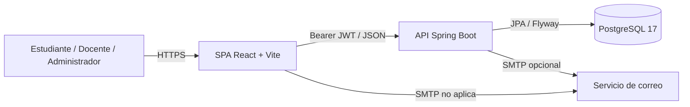

# Arquitectura y despliegue as-built (#146)

**Estado:** arquitectura local verificada. Staging pendiente de #33.

## 1. Vista general



- **Frontend:** React 19, Vite 8, React Router 8, MUI, Axios, Recharts, KaTeX.
- **Backend:** Spring Boot 4.1, Java 21, Spring Security + OAuth2 Resource Server, Spring Data JPA, Flyway, Springdoc.
- **Base de datos:** PostgreSQL 17. Flyway es la única fuente del esquema; Hibernate solo valida (`ddl-auto: validate`).
- **Correo:** integración SMTP opcional para invitaciones. Sin `MAIL_HOST`, `MAIL_USERNAME` y `MAIL_PASSWORD`, el backend registra el enlace en el log (modo local/test).

## 2. Módulos implementados

| Módulo | Responsabilidad |
|---|---|
| `seguridad` / `usuario` | Login JWT, roles, usuarios, grupos, invitaciones |
| `diagnostico` | Prueba de 24 ítems, respuestas, puntaje, categoría y niveles |
| `practica` | Motor adaptativo, intentos, idempotencia, retroalimentación y niveles |
| `contenido` | Contenidos, ejercicios y banco semilla |
| `progreso` | Indicadores del estudiante e historial |
| `analitica` | Indicadores de grupo y derivados para el docente |
| `admin` | Panel, usuarios e invitaciones |

## 3. Modelo de datos

El detalle está en [`docs/base-de-datos/modelo-fisico.md`](../base-de-datos/modelo-fisico.md). Las migraciones aplicadas son:

- V1: esquema inicial (rol, usuario, competencia).
- V2: datos base.
- V3: esquema del diagnóstico.
- V4: banco de ítems.
- V5: esquema de práctica.
- V6: banco semilla de ejercicios.
- V7: grupos y asociación docente–estudiante.
- V8: invitaciones de estudiantes.

## 4. Variables de entorno

### Backend

| Variable | Uso |
|---|---|
| `SPRING_PROFILES_ACTIVE` | Perfil (`dev` en local; `staging`/`prod` en despliegue) |
| `SPRING_DATASOURCE_URL` / `_USERNAME` / `_PASSWORD` | Conexión a PostgreSQL |
| `JWT_SECRET` | Llave HS256, mínimo 32 caracteres |
| `JWT_EXPIRATION_MINUTES` | Duración del token (por defecto 120) |
| `CORS_ORIGINS` | Orígenes permitidos del frontend |
| `MAIL_HOST` / `MAIL_PORT` / `MAIL_USERNAME` / `MAIL_PASSWORD` | SMTP de invitaciones (Gmail: `smtp.gmail.com` / `587` / contraseña de aplicación) |
| `MAIL_SMTP_AUTH` / `MAIL_STARTTLS` | Autenticación y STARTTLS del SMTP |
| `MAIL_HEALTH_ENABLED` | Incluir el correo en `/actuator/health` (por defecto `false`) |
| `MAIL_FROM` | Remitente; si se omite, usa `MAIL_USERNAME` |
| `FRONTEND_URL` | URL usada para armar el enlace `/registro?token=…` |

### Frontend

| Variable | Uso |
|---|---|
| `VITE_API_URL` | URL base de la API (`http://localhost:8080/api` en local) |
| `VITE_USE_MOCKS` | `true` para datos simulados; `false` para backend real |

## 5. Instalación local

```powershell
# Backend en Docker (todo junto)
cd aprendizaje-usco-backend
docker compose up -d --build

# Alternativa: backend local con Maven
# docker compose up -d postgres pgadmin
# .\mvnw.cmd spring-boot:run

# Frontend
cd ..\aprendizaje-usco-frontend
npm install
npm run dev
```

Comprobaciones:

- Backend: http://localhost:8080/actuator/health → `UP`.
- Swagger: http://localhost:8080/swagger-ui.html.
- Frontend: http://localhost:5173.

Usuarios de prueba (`dev`): `estudiante@aprendizaje.test`, `docente@aprendizaje.test`, `admin@aprendizaje.test`; contraseñas en el README del backend.

## 6. Despliegue

### Backend

1. Definir variables de entorno (base, JWT, CORS, correo).
2. Ejecutar `.\mvnw.cmd -DskipTests package` o usar el `Dockerfile`.
3. Configurar el perfil de staging y verificar `/actuator/health`.
4. Ejecutar las migraciones Flyway al arrancar.

### Frontend

1. Configurar `VITE_API_URL` con la URL pública del backend.
2. Ejecutar `npm run build`.
3. Publicar `dist/` con reescritura de rutas hacia `index.html` para React Router.

### Pendiente

- URL real de staging y proveedor de hosting (#33).
- Rotación de secretos y verificación de CORS en staging.
- Repetir la validación de los flujos E2E y la matriz CA en staging.
