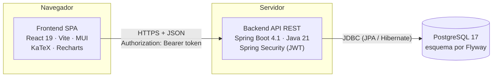
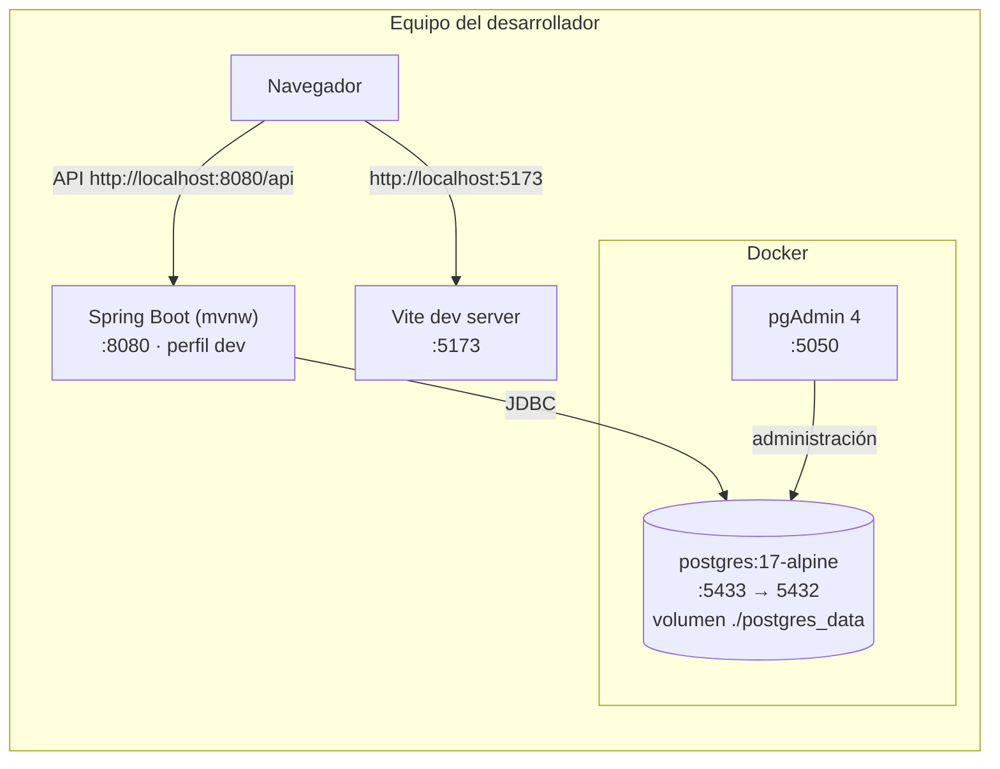

# Manual técnico de Aprendizaje USCO

Arquitectura **tal como quedó implementada**, despliegue, instalación completa (backend y frontend) y mapa de la documentación. Es insumo del capítulo 6 del informe.

Cada repositorio tiene además su propia documentación:
- **README:** cómo correrlo, configuración y convenciones.
- **implementacion.md:** qué se construyó, historia por historia.

> Estado al 10 de noviembre de 2026. En el repositorio todavía no hay configuración de staging (SCRUM-13); por eso el despliegue descrito es el local. Cuando exista, se completa la sección 2.

---

## 1. Arquitectura

Aplicación web de tres capas: una SPA en el navegador, una API REST sin estado y una base de datos relacional.



| Capa | Tecnología | Responsabilidad |
|---|---|---|
| Frontend | React 19, Vite 8, React Router, MUI, Axios, KaTeX, Recharts | Pantallas por rol, validación de formularios, notación matemática, gráficos. Guarda el token en `localStorage` y lo envía en cada petición |
| Backend | Java 21, Spring Boot 4.1, Spring Security, Spring Data JPA, springdoc (Swagger) | Reglas de negocio, autenticación y autorización por rol, cálculo de puntajes y niveles, persistencia |
| Base de datos | PostgreSQL 17, migraciones Flyway | Datos de usuarios, diagnóstico, práctica y grupos. Ver [modelo físico](base-de-datos/modelo-fisico.md) |

**Decisiones de arquitectura.**

- **API sin estado con JWT (HS256).**
  - El servidor no guarda sesiones; cada petición trae su token con el id (`sub`), el correo y el rol.
  - Permite escalar el backend sin compartir memoria.
  - Detalle en `implementacion.md` §1.
- **El backend es la barrera de seguridad.**
  - Cada endpoint exige su rol con `@PreAuthorize`, y `ProteccionDeEndpointsTest` falla si alguno no lo tiene.
  - El frontend solo evita navegar a pantallas de otro rol.
- **Monolito modular.**
  - Un solo backend organizado por módulo funcional: `usuario`, `diagnostico`, `practica`, `contenido`, `progreso` y `analitica`, cada uno con sus capas (README §5).
  - Para el tamaño del equipo es más simple que microservicios y mantiene los módulos separados.
- **El esquema solo lo cambia Flyway.** Hibernate solo valida (`ddl-auto: validate`), así que el esquema es el mismo en todos los entornos.

## 2. Despliegue

### 2.1 Desarrollo local (as-built)



| Componente | Puerto en el equipo | Cómo se levanta |
|---|---|---|
| Frontend (Vite) | 5173 | `npm run dev` |
| Backend (Spring Boot) | 8080 | `./mvnw spring-boot:run`. Con el perfil `dev`, Spring Boot levanta solo los contenedores de `compose.yaml` |
| PostgreSQL 17 | 5433 (solo `127.0.0.1`) | Contenedor `postgres` de `compose.yaml`; datos en `postgres_data/` (no se versiona) |
| pgAdmin 4 | 5050 (solo `127.0.0.1`) | Contenedor `pgadmin` de `compose.yaml` |

Todos los puertos se publican solo en `127.0.0.1`: no quedan expuestos a la red.

### 2.2 Backend en contenedor

El `Dockerfile` del backend compila con Maven y corre el `.jar` sobre `eclipse-temurin:21-jre`. Por defecto, `docker compose up -d --build` levanta API, base y pgAdmin juntos:

```bash
docker compose up -d --build
```

Si prefieres el backend local con Maven, levanta solo la base y pgAdmin:

```bash
docker compose up -d postgres pgadmin
```

Así el backend en contenedor se conecta a `postgres:5432` por la red interna de Docker.

### 2.3 Staging (pendiente, SCRUM-13)

Aún no existe. Lo que ya está listo para cuando se configure:
- **Llave de los tokens:** fuera del perfil `dev` la app exige `JWT_SECRET` y no arranca sin ella.
- **Conexión:** la base se configura con `SPRING_DATASOURCE_*` y el origen del frontend con `CORS_ORIGINS`.
- **Datos de prueba:** los usuarios de prueba solo se cargan con el perfil `dev`.

## 3. Guía de instalación completa

**Requisitos:** Git, JDK 21 (Temurin), Docker Desktop y Node.js 24.

```bash
# 1. Backend
git clone https://github.com/aprendizaje-usco-project/aprendizaje-usco-backend.git
cd aprendizaje-usco-backend
git checkout develop
cp .env.template .env            # Windows: copy .env.template .env  → llenar los valores
./mvnw spring-boot:run           # Windows: mvnw.cmd spring-boot:run  (Docker Desktop abierto)

# 2. Frontend (en otra terminal)
git clone https://github.com/aprendizaje-usco-project/aprendizaje-usco-frontend.git
cd aprendizaje-usco-frontend
git checkout develop
npm install                      # Windows con PowerShell: npm.cmd install
cp .env.example .env.development
npm run dev
```

**Verificación:**

| Qué | Dónde | Esperado |
|---|---|---|
| API viva | http://localhost:8080/actuator/health | `{"status":"UP"}` |
| Documentación de la API | http://localhost:8080/swagger-ui.html | Swagger UI |
| Aplicación | http://localhost:5173 | Pantalla de inicio de sesión |
| Ingreso | `estudiante@aprendizaje.test` / `Estudiante2026*` | Inicio del estudiante |

Los demás usuarios de prueba están en el README del backend, §7. Si algo falla, revisa «Problemas frecuentes» en el README de cada repositorio.

## 4. Módulos y endpoints

Todas las rutas empiezan por `/api`. Las únicas públicas son `POST /auth/login` y `POST /auth/registro`; el resto exige token. El contrato completo está en Swagger.

| Módulo | Endpoint | Rol | Para qué |
|---|---|---|---|
| usuario | `POST /auth/login` | público | Inicia sesión y devuelve el token |
| usuario | `POST /auth/registro` | público | Registra un estudiante |
| usuario | `GET /auth/me` | con sesión | Datos del usuario del token |
| usuario (grupos) | `POST /grupos` | DOCENTE | Crea un grupo |
| usuario (grupos) | `GET /grupos` | DOCENTE, ADMIN | Lista los grupos del docente (todos para el admin) |
| usuario (grupos) | `GET /grupos/{id}/estudiantes` | DOCENTE, ADMIN | Estudiantes de un grupo |
| usuario (grupos) | `POST /grupos/{id}/estudiantes` | DOCENTE, ADMIN | Inscribe un estudiante por su correo |
| usuario (invitaciones) | `GET/POST /grupos/{id}/invitaciones` y `POST /grupos/{id}/invitaciones/{id}/reenviar` | DOCENTE dueño, ADMIN | Carga el listado, consulta estado y reenvía invitaciones (SCRUM-150) |
| usuario (invitaciones) | `GET /auth/invitacion?token=…` | público | Datos para precargar el registro desde el enlace |
| usuario (administración) | `GET/POST /admin/usuarios`, `PUT /admin/usuarios/{id}` y `PATCH /admin/usuarios/{id}/estado` | ADMIN | Listar con búsqueda y filtros, crear con contraseña temporal, editar el rol y activar o desactivar (SCRUM-45) |
| usuario (administración) | `GET /admin/resumen` | ADMIN | Conteos del panel: usuarios por rol, grupos y actividades activas (SCRUM-46) |
| contenido (administración) | `GET /admin/actividades` | ADMIN | Catálogo de contenidos y ejercicios de todos los docentes, sin claves ni explicaciones (SCRUM-46) |
| diagnostico | `POST /diagnosticos/intentos` | ESTUDIANTE | Inicia la prueba |
| diagnostico | `GET /diagnosticos/intentos/actual` | ESTUDIANTE | Intento en curso o finalizado |
| diagnostico | `GET /diagnosticos/intentos/{id}` | ESTUDIANTE | Ítems y respuestas guardadas |
| diagnostico | `PUT /diagnosticos/intentos/{id}/respuestas/{itemId}` | ESTUDIANTE | Guarda una respuesta |
| diagnostico | `POST /diagnosticos/intentos/{id}/finalizar` | ESTUDIANTE | Entrega la prueba y calcula el resultado |
| diagnostico | `GET /diagnosticos/intentos/{id}/resultado` | ESTUDIANTE | Puntaje, categoría y resultado por competencia |
| practica | `GET /practica/siguiente` | ESTUDIANTE | Siguiente ejercicio según el nivel |
| practica | `POST /practica/intentos` | ESTUDIANTE | Registra un intento (idempotente) |
| progreso | `GET /progreso/me` | ESTUDIANTE | Indicadores de progreso del estudiante: intentos, ejercicios completados, nivel general y por competencia, variación frente al diagnóstico y tendencia semanal (README §15) |
| progreso | `GET /historial` | ESTUDIANTE, DOCENTE | Historial de resultados con filtros; el docente solo ve estudiantes de sus grupos |
| analitica | `GET /analitica/grupos/{grupoId}` | DOCENTE | Resumen del grupo: promedios, distribución de categorías, riesgo y estudiantes (SCRUM-39) |
| analitica | `GET /analitica/grupos/{grupoId}/estudiantes/{estudianteId}` | DOCENTE | Detalle del estudiante dentro del grupo (SCRUM-39) |
| contenido | `GET/POST /contenidos`, `PUT/DELETE /contenidos/{id}` y `PATCH /contenidos/{id}/estado` | DOCENTE | Crear, editar, activar o desactivar y borrar sus contenidos (SCRUM-43) |
| contenido | `GET/POST /ejercicios`, `PUT/DELETE /ejercicios/{id}` y `PATCH /ejercicios/{id}/estado` | DOCENTE | Crear, editar, activar o desactivar y borrar sus ejercicios; si ya tienen intentos, solo se desactivan (SCRUM-43) |

`GET /api/ping/{rol}` solo existe con los perfiles `dev` y `test`, para probar el acceso por rol.

## 5. Seguridad

| Aspecto | Implementación |
|---|---|
| Contraseñas | BCrypt; nunca se devuelven ni se escriben en logs |
| Autenticación | JWT HS256 de 2 h con `sub`, `correo` y `rol`; llave en `JWT_SECRET` (≥ 32 caracteres) |
| Autorización | Rol desde el claim `rol` (`JwtRoleConverter`); `@PreAuthorize` en cada endpoint |
| Errores | 401 sin token o con token inválido; 403 rol sin permiso; siempre con el formato estándar de error |
| Aislamiento de datos | El id del usuario sale del token, nunca del cliente; un estudiante solo ve lo suyo, un docente solo a estudiantes de sus grupos y solo puede editar los contenidos y ejercicios que creó (403 en los demás) |
| CORS | Solo los orígenes de `CORS_ORIGINS` |
| Cabeceras | `X-Content-Type-Options`, `X-Frame-Options`, `Referrer-Policy`, `Permissions-Policy` y `Cache-Control: no-store` en `/api/**` |
| Invitaciones | Token aleatorio de un solo uso guardado como hash SHA-256; vence a los 7 días y exige coincidencia de correo |
| Datos personales (Ley 1581) | Autorización de datos al iniciar el diagnóstico; los usuarios de prueba solo existen en `dev` |

Las limitaciones conocidas, como la revocación de tokens o la falta de límite de intentos de login, están en el README del backend, §11.

## 6. Calidad

| Qué | Cómo |
|---|---|
| Pruebas del backend | JUnit 5, MockMvc y Testcontainers, con PostgreSQL real en Docker: `./mvnw test` |
| Pruebas del frontend | Vitest y Testing Library: `npm test` |
| Integración continua | GitHub Actions en cada PR y push a `develop` y `main`. Backend: `./mvnw verify` con Java 21. Frontend: `npm ci`, lint, pruebas y build con Node 24 |
| Accesibilidad | Lighthouse Accessibility 100 en las pantallas principales y uso completo con teclado, incluidos los dashboards de progreso y del docente (frontend, `implementacion.md` §8) |
| Rendimiento | k6 con 30 usuarios concurrentes durante 1 minuto (RNF-02: p95 < 1 s). El 9 de noviembre: p95 de 20.20 ms en `GET /practica/siguiente` y de 20.97 ms en `POST /diagnosticos/intentos/{id}/finalizar`, sin errores. Script en `pruebas/rendimiento/` (SCRUM-44) |
| Cobertura | JaCoCo por línea de comandos (backend, `implementacion.md` §3) |

## 7. Mapa de la documentación

| Documento | Contenido |
|---|---|
| `docs/README-backend.md` · `docs/README-frontend.md` | Cómo correr cada parte, configuración, estructura, convenciones, problemas frecuentes |
| `docs/implementacion.md` (cada repo) | Lo construido historia por historia: decisiones, pruebas, cómo probarlo |
| `docs/base-de-datos/modelo-fisico.md` | Modelo de datos final: diagrama completo, tablas, restricciones y decisiones |
| `docs/code/motor-practica-adaptativa.md` | Diseño del motor de práctica adaptativa |
| `docs/code/retroalimentacion-e-idempotencia.md` | Retroalimentación inmediata, trazabilidad e idempotencia de los intentos de práctica |
| `docs/code/indicadores-grupo-docente.md` | Indicadores de grupo para el docente (SCRUM-39) |
| `docs/code/gestion-actividades-contenidos.md` | Gestión de contenidos y ejercicios por el docente (SCRUM-43) |
| `docs/code/rendimiento-servicios-criticos.md` · `pruebas/rendimiento/` | Pruebas de rendimiento con k6 y sus resultados (SCRUM-44) |
| `docs/documentación física/` | Documento maestro, requisitos e historias de usuario, plan de pruebas |
| `docs/pruebas/` | Matriz CA-01 a CA-16, incidencias, protocolo, consentimiento y observaciones de usabilidad |
| `docs/entrega/arquitectura-despliegue.md` | Arquitectura as-built, diagrama de despliegue, variables y guía de instalación (#146) |
| `docs/tareas-y-responsables.md` | Qué pide cada tarea y quién la tiene |
| `CONTRIBUTING.md` (cada repo) | Ramas, commits y PR |
